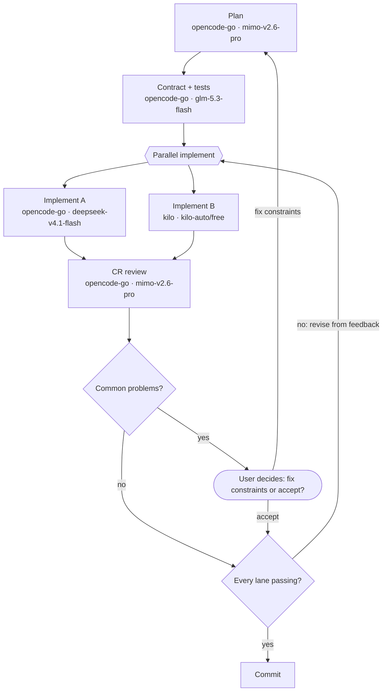

# dsh-racing-code

> **Status: v0.2.0 — implemented and installed in this machine's `web` profile.** Zero dependencies, no build,
> host half plus a pure layer, 96 tests green; new in this release: **first-run bootstrap for new projects**
> (see the "New-project bootstrap" subsection in §5). Installation, per-agent registration of the section and the tool,
> the section actually reaching the prompt, live refresh on file edits, live reload of the Config, and
> "not declared → not enabled" were all verified in a real session
> (evidence in [doc/development.md](doc/development.md) §M4).

**racing = multiple models run the same sector at once, each in its own lane, with a CR as the judge who sends
its notes back to the lanes until they pass.**

**Each project writes its own flow markdown** (the workflow drawn as a mermaid diagram, with each stage's model
written right on the node label). The plugin parses it, injects the diagram into that session's system prompt,
and lets the main session run it. **There is no global flow and no built-in fallback** — if a project has no such
file, the plugin **stays silent** for that project (no prompt section, no `flow_stages`; its only trace is the
`racing_code_init` bootstrap tool you invoke explicitly — see §5).

### Quick start

```bash
# 1) install (already installed here: dsh.profile.bundles contains dsh-racing-code)
plugin_manager  install_bundle  /home/liumenghan/dsh-racing-code

# 2) give the project a flow; this repository's own file is a good starting point
mkdir -p doc && cp /home/liumenghan/dsh-racing-code/main/doc/racing-code.md doc/racing-code.md
#    or just tell the orchestrator: start racing-code for this project (template -> confirm flow -> pick models)

# 3) ask what is in force (read-only, re-read from disk):
#    the orchestrator calls flow_stages, and the system prompt carries the same flow
```

Installing changes nothing by itself — until a project declares its flow (deliberately, see §3). Every route the
diagram mentions must be added to the allowlist **by hand** in
`Settings → Plugins → Subagent delegation`; the plugin tells you which one is missing.

```text
<your project>/doc/racing-code.md      ← the only source: stages, order, lanes, branches, review rounds, models
(no file = no flow; the plugin injects nothing, only the racing_code_init bootstrap tool remains)
```

Grammar and semantics: [doc/workflow-format.md](doc/workflow-format.md). Rationale:
[doc/architecture.md](doc/architecture.md). Chinese version: [README.zh.md](README.zh.md).

---

## 1. What it fixes

| | Today (native surface) | With dsh-racing-code |
|---|---|---|
| Flow differs per project | one prose skill saying "do TDD", obeyed or not | **one markdown per project** |
| Which stages exist, in what order | no notion of a stage | mermaid nodes and edges *are* the stages and the order |
| One stage, one model | you pick a single model | **parallel lanes**: N models, N worktrees, N independent takes on the same contract |
| Who did it better | nothing to compare — first one done wins | a **CR stage** scores each lane and lists its problems |
| Getting it fixed | either you police every round by hand, or it is quietly dropped | **review rounds**: the CR sends each lane its own problems back to **that lane's model**, which revises in the same worktree/branch, and the loop repeats **until every lane passes — only then is a winner declared** (bounded rounds) |
| Hitting the same wall twice | a human has to notice "this again?" | **common problem → constraint gap**: two lanes failing the same way are *not* each told to work around it; the flow asks you whether to fix the constraint |
| Branches and loops ("red → back to implement") | prose only | conditional edges, back edges, user gates |
| Model per stage | only "which models may subagents use" | written on the node label (or in the same file's front matter) |
| Cost of a change | edit global config, restart a session | edit **that project's markdown**; effective on the **next model step** |
| Is the flow obeyed? | no guarantee | the host half injects the flow per agent; `flow_stages` returns exact routes, lanes and the join |

The native allowlist (`subagent-model-selection-settings`) stays a hard constraint: a route written in the
diagram must be in it, or delegation is refused. The plugin flags unauthorized routes and tells you which one is
missing and where to add it — but **the GUI no longer merges it for you** (see §7).

## 2. Why "racing"

| Metaphor | What it maps to |
|---|---|
| Lane | each out-edge of a **parallel group node** `{{…}}`: one git worktree, one model, one independent take |
| Green flag | the orchestrator launches **every lane in one message**, never one after another |
| Physical isolation | one `git worktree` + branch per lane (`racing/<lane-id>`) so lanes cannot overwrite each other. The directory defaults to `<project root>/.worktrees/<lane-id>`; with `laneDir: branch` in the flow file it **equals the branch name** (e.g. `racing/implement-a`), matching a container layout where every branch has its own directory |
| Judge (CR) | all lanes converge on a **review stage** that scores each take against the same standard |
| Review round | the CR sends **each lane its own problems** back to **that lane's own model** (`send_message` to the same child), which revises in the same worktree/branch and commits; the CR re-reviews, and **only when every lane is clean does that round declare a winner** (at most `maxReviewRounds`, default 2 — past that it asks you) |
| The signal that matters | a **common problem** (≥2 lanes failing the same way) ≈ an ambiguous or missing constraint. Letting each lane work around it would disguise a spec gap as a style difference, so it **never goes to the lanes** — it stops and asks you |
| User gate | "fix the constraint and re-run" or "accept as is" (accepted problems go on an *accepted list* and stop blocking later rounds) |
| Independence | lanes **never look at each other**: feedback is split per lane, and never includes the other lane's problems or the score comparison |
| Front wing | the contract and its tests are written **once** (`contract-tests`) so every lane implements the same spec — otherwise comparison is meaningless |

## 3. When it is enabled, and the only source

| Situation | Plugin behaviour |
|---|---|
| The project has **no** `doc/racing-code.md` | **Silent**: no prompt section, no `flow_stages`; the `racing_code_init` bootstrap tool appears only when you explicitly say "start racing-code" (`bootstrapEnabled: false` turns even that off, see §5) |
| The file exists and the diagram parses | **Enabled**: inject the flow section and register `flow_stages` |
| The file exists but the diagram is broken | **No flow injected** — only **one diagnostic line**; `flow_stages` returns the full diagnostics, and `racing_code_init` is registered too (preview only by default; `force` replaces the broken file) |

- The path defaults to `doc/racing-code.md` and is configurable via `projectFlowPath`;
- **models live in the same file**: the second line of a stage's node label
  (`"Implement A<br/>opencode-go · deepseek-v4.1-flash"`) or the front matter's `models:` — equivalent, label wins.
  So "how this project works" is **one file, one commit, one review**;
- **upgrading the plugin never changes a project's flow** — flows only travel with the project file;
- enabled/disabled is decided when the **agent is created**: creating the file mid-session needs a new session to
  enable; deleting it degrades the current session to a single diagnostic line.

**Why no global layer**: a global flow table degenerates into the greatest common divisor of every project's
process; a built-in fallback pushes someone else's stages into projects that never asked for them; and both would
need a "which layer won" rule plus its own diagnostics. One layer, one rule: **declared → run it; not declared →
don't run at all.**

## 4. What a flow file looks like

````markdown
---
racing-code: 1
maxLanes: 4
maxReviewRounds: 2
models:
  commit: kilo/kilo-auto/free            # front-matter form (equivalent to the label form)
---

# Our flow



## Stage briefs

### implement-a
Implement against the contract, drive the tests to green. Output: diff + test output.
````

A node's **shape** decides its kind ([full grammar and semantics](doc/workflow-format.md)):

| Shape | Kind | Who runs it |
|---|---|---|
| `id["label<br/>provider · model"]` | **stage** | a declared model means a delegated child, no declaration means it runs in the current session; the optional second label line is its model |
| `id{{"label"}}` | **parallel group** | not a stage: each of its out-edges starts a **lane** |
| `id{"question"}` | **decision** | the model gives advice and evidence, **the user** decides (`ask_user_question`) |
| `id(["label"])` | **user gate** | **the user** decides; the edge labels are the options offered |

- A cyclic diagram needs a `%% entry: <node id>` line (without it, an ambiguous entry reports
  `FLOW_AMBIGUOUS_ENTRY`);
- A back edge re-runs something: pointed at a **stage** it re-runs that stage (`maxStageRepeats`, default 3);
  pointed at a **parallel group** it opens a **new review round** (`maxReviewRounds`, default 2). Past either
  limit the orchestrator stops and asks you;
- a `### <stage id>` section is that stage's **delegation prompt skeleton**, returned on demand by `flow_stages`;
- everything else in the file is free prose for humans — it never enters the prompt, so the markdown doubles as
  the project's flow documentation;
- **lane isolation is a hard constraint**: the directory comes from the front matter's `laneDir` (default
  `<project root>/.worktrees/<lane-id>`; `laneDir: branch` gives `<project root>/racing/<lane-id>`, i.e. directory
  equals branch name), with branch `racing/<lane-id>`,
  **reused across rounds** (same worktree, same branch, same model — a round is not a new lane). The `subagent`
  tool has no cwd parameter, so a lane's prompt must spell out the worktree's absolute path (template in the
  spec, §11).

## 5. A starting flow (example) and this repository's own flow

The "two lanes + CR review rounds" flow below is the smallest useful shape; this repository uses it too
([doc/racing-code.md](doc/racing-code.md), plus a "design signed off" user gate):

| Stage | What it does | Example route |
|---|---|---|
| `plan` | approach + acceptance criteria; settle the lane directory (`laneDir`): default `.worktrees` needs a `.gitignore` line, `branch` mode needs none | `opencode-go` · `mimo-v2.6-pro` |
| `contract-tests` | signatures, contract comments, tests per contract, run once and show **red** (the **shared standard** for every lane) | `opencode-go` · `glm-5.3-flash` ⁽¹⁾ |
| `race{{Parallel implement}}` | a **parallel group** (not a stage, no route): starts all lanes at once | — |
| `implement-a` | lane 1: implement to green inside its own worktree | `opencode-go` · `deepseek-v4.1-flash` |
| `implement-b` | lane 2: same contract, another model, another worktree | `kilo` · `kilo-auto/free` |
| `cr` | reviews each round: per-lane score and issues → **single-lane problems go back to that lane**, **common problems go to the user** → a winner only in the round where every lane passes | `opencode-go` · `mimo-v2.6-pro` |
| `common` / `verdict` | two decisions: any common problems? is every lane passing? | — |
| `gate` (user gate) | on common problems, ask the user: fix constraints and re-run, or accept | — |
| `commit` | commit the winner; remove the losing worktree, **keep its branch** | `kilo` · `kilo-auto/free` |

⁽¹⁾ Originally `mimo-v2.6-flash`: it is listed and answers non-streamed requests, but the upstream replies
`[model_coming_soon]` to every **streamed** request, and DSH only streams — so it is unusable today (see
[doc/compatibility.md](doc/compatibility.md) §2).

Typical edits: add a third lane (one more out-edge plus one more stage; `maxLanes` allows 4 by default); point the
CR at a stronger model; tighten or loosen the review loop; add a release gate. **To change models, edit labels or
front matter only — never the structure.**

### New-project bootstrap (v0.2.0)

With no flow file yet the plugin **stays silent**, but you can simply tell the orchestrator **"start racing-code for
this project"**: it calls `racing_code_init` (whose first description sentence is fixed: call only when the user
explicitly asks to set up a flow for this project; preview only, never writes by default) and walks **three steps**
through **two user interventions**:

1. **Preview** (`write: false`): a structural preview — mermaid diagram, stage list, first-run checklist, pre-flight
   `plan`, per-node `nodes` choices and the nine-step protocol — with **every stage model rendered as
   `session`**, so the structure stays the focus;
2. **Two interventions**: ① **confirm the flow** (presets `full` / `minimal`, lane count, stage briefs are all
   editable); ② **confirm each node's model** (tabs: `use the current session model (default)` plus the
   allowlist ∩ llm catalog candidates; **lanes are required picks**);
3. **Write** (`write: true`): a `resolveFlow` zero-error self-check first, `createIfAbsent` by default (an
   existing file is not overwritten; `force` takes `replaceIfVersion`); missing lane choices refuse the write
   with `BOOTSTRAP_CHOICE_REQUIRED`, a `plan` with a blocked item with `BOOTSTRAP_PLAN_BLOCKED` → the flow
   takes effect only in a **new session** (`BOOTSTRAP_RESTART_REQUIRED`).

**Stages split by declaration**: a stage is delegated only when a model is declared for it; without a
declaration (`session`/missing key) it runs directly in the current session. **Lanes always delegate** (a lane
picking `session` means the child inherits the session model); `commit` delegates because the configuration
declares a model for it.
**The `session` sentinel**: writing `design: session` in the models table means the user **has picked** "declare
no model" (`routeSource: 'session'`) — an undeclared non-lane stage runs directly in the current session, an
undeclared lane delegates on the session model — and it does **not** report `FLOW_ROUTE_MISSING`; only a
**missing key** does. Write safety: the target is pinned to `projectFlowPath`, writes outside the root are
refused, unverifiable text never lands (zero-error self-check), preview is the default, and overwriting always
takes an explicit `force`. Details: [doc/bootstrap.md](doc/bootstrap.md).

## 6. Configuration

The Loader row id and settings namespace are both `racing-code`. There is **no settings page** (§7), so these
fields are edited in the profile patch's `racing-code` row `config` (defaults ship in the bundle patch):

| Field | Type | Default | Meaning |
|---|---|---|---|
| `enabled` | boolean | `true` | master switch (turn everything off temporarily) |
| `bootstrapEnabled` | boolean | `true` | master switch for the new-project bootstrap: `false` keeps even the "no file" case **fully silent** (no `racing_code_init`) |
| `projectFlowPath` | string | `doc/racing-code.md` | the only source, relative to the project root |
| `maxStageRepeats` | number | `3` | default back-edge guard (overridable in front matter) |
| `maxLanes` | number | `4` | max lanes per parallel group (overridable in front matter) |
| `maxReviewRounds` | number | `2` | max "CR feedback → lane revision" rounds (overridable in front matter) |

## 7. Why there is no settings page

The previous GUI page existed for exactly one reason: editing the global stage/route table. With the global layer
gone, no host-side state needs editing — the flow and its models live in the project file, which is the editor's
and the model's home turf. So the whole client half (`dsh.client`, hand-written bundle, locale, form service,
model catalog dropdown, plugin-owned HTTP route) is **deleted**: what remains is the host half, the pure
functions, and the source reader.

The trade-off is that **the allowlist is maintained by hand**: add the routes you use in the built-in
**Settings → Plugins → Subagent delegation** page. The plugin tells you exactly which route is missing, but it no
longer writes it for you.

## 8. Runtime behaviour

1. When a session's agent is created, the host half reads `<project root>/doc/racing-code.md` using
   `agent.session.header.cwd`: missing → **stay silent** (only the `racing_code_init` bootstrap tool, see §5);
   present → parse the diagram, merge routes (label >
   front matter > current session model), check the allowlist and CR-model reuse, and cache the result
   (last-known-good).
2. When enabled it registers one **system-prompt section** (order 700) on that root agent — file path, compact
   diagram, per-stage routes (unconfigured/unauthorized flagged), execution rules, review-round rules — and
   registers `flow_stages` **in the same agent scope**. Section text renders synchronously; no I/O.
3. The orchestrator runs the diagram: a sequential stage splits **by declaration** — with a declared model it
   is one foreground `subagent` call with an explicit `provider`/`model` and a self-contained prompt, without
   one it runs directly in the current session; **lanes always delegate**; `commit` delegates because the
   configuration declares a model for it. Entering a **parallel group** launches every lane in one message and
   waits for all of them before the join.
4. Each lane works inside its own worktree and commits to its own branch; the CR reads every worktree, scores
   each take, triages **single-lane problems** vs **common problems**, and traces each common problem to the
   constraint it suggests is missing.
5. **Review rounds**: single-lane problems are split per lane and `send_message`d back to **that lane's original
   child**, which revises in the same worktree/branch and commits — only the named lanes re-run. The CR
   re-reviews just the new diff, and **only when every lane is clean does that round declare a winner** and move
   to `commit` (past `maxReviewRounds` it stops and asks you).
6. Common problems → the user gate (`ask_user_question`, whose options are exactly the edge labels); anything
   accepted goes on an *accepted list* and stops blocking later rounds.
7. `flow_stages` returns exact routes, lanes/join points, back edges with round limits, a stage's prompt
   skeleton, and a **rendered "mermaid diagram with models"** that can be pasted to the user or into docs.
8. Editing the project's flow file takes effect on the **next model step**; creating or deleting it changes
   enabled/disabled only for **new** sessions; allowlist changes need a new session.

## 9. Install

```text
plugin_manager  install_bundle  /home/liumenghan/dsh-racing-code
```

**Nothing happens after installing** — until a project declares its flow (or you explicitly say "start racing-code
for this project" and walk the bootstrap, see §5). To try it:

```bash
mkdir -p doc && cp <this repo>/doc/racing-code.md doc/racing-code.md    # or write your own
```

Prerequisites are already in `~/.dsh/profiles/web/cordis.patch.yml` and verified with
`dsh --profile web --dump-config`: `mimo-v2.6-pro` added to the `opencode-go` catalog, the `kilo` route switched
from `apiKeyEnv` to two static headers (`x-api-key: FREE` plus `authorization: Bearer`, because the free tier
rejects any real bearer while pi-ai refuses a credential-less route), and subagent model selection enabled —
**every route written in your diagram must be in its `allowedModels`** (added by hand; the plugin no longer merges
them). All four routes used below have been exercised with a real delegated child, not merely read off the
catalog: `mimo-v2.6-pro` ✅, `glm-5.3-flash` ✅, `deepseek-v4.1-flash` ✅, `kilo · kilo-auto/free` ✅.

## 10. Layout

**This repository is laid out as a worktree container**: the project directory is not a repository working
tree but a container holding the bare repository plus one directory per branch.

```text
/home/liumenghan/dsh-racing-code/       ← project directory = container (git works, but there is no work tree)
├── .bare/                              bare repository: objects / refs / origin
├── .git                                a file containing: gitdir: ./.bare
└── main/                               the worktree for branch main — the tree below lives inside it
    ├── package.json      cordis.patch.yml      locale/{zh,en}.json
    ├── lib/index.js      # host half: ~standard Config, per-agent section + tools (incl. racing_code_init), cache/refresh/teardown
    ├── lib/flow.js       # pure layer: mermaid/YAML subset, graph rules, lanes, loops, routes, rendering
    ├── lib/bootstrap.js  # bootstrap pure layer: full/minimal templates, node choices, pre-flight plan, protocol
    ├── lib/sources.js    # source layer: read, enablement (disabled/missing/unreadable/invalid/ok), watch
    ├── test/             # node --test: flow / sources / bootstrap / host / package (96 cases)
    └── doc/{racing-code.md, bootstrap.md, workflow-format.md, architecture.md, compatibility.md, development.md}
```

There is no client half: no `dsh.client`, no bundle, no settings page (§7).

Two consequences of that layout:

1. **Working-tree commands run inside `main/`** (`git -C main status`, `npm test` with absolute paths under
   `main/`). The container root is for repository-wide operations only (`git worktree list`, `git fetch`,
   `git branch`); it has no work tree, so `git status` there reports `must be run in a work tree` — expected.
2. **The flow file is the tracked `main/doc/racing-code.md`**, while a session's cwd is the container root, so the
   plugin needs to be pointed at it:

   ```yaml
   # ~/.dsh/profiles/web/cordis.patch.yml
   - id: racing-code
     config:
       projectFlowPath: main/doc/racing-code.md
   ```

   Lane directories follow the same rule: this repository's flow sets `laneDir: branch`, so the two lanes land in
   `racing/implement-a/` and `racing/implement-b/`, siblings of `main/` — **the directory name is the branch name**.
   A normal repository (session cwd = the working tree) keeps the default `.worktrees/` and ignores it in git.

   The bundle itself is **installed from `main/`** (`install_bundle /home/liumenghan/dsh-racing-code/main`)
   because `package.json` lives in the worktree — an unavoidable consequence of developing a plugin inside its own
   repository: point a new install at whichever worktree holds the code, and restart dsh to load the new module
   generation.

## 11. Docs

| Document | Audience |
|---|---|
| [doc/workflow-format.md](doc/workflow-format.md) | Flow authors: mermaid subset, lanes and joins, user gates, in-diagram model labels, diagnostics, execution semantics |
| [doc/racing-code.md](doc/racing-code.md) | This repository's own flow (example and starting point) |
| [doc/architecture.md](doc/architecture.md) | Maintainers: rationale, the host half, lanes and CR, failure modes, decision log |
| [doc/compatibility.md](doc/compatibility.md) | Maintainers: the official contracts relied on, how each was verified, failure symptoms |
| [doc/development.md](doc/development.md) | Implementers and maintainers: milestones, interface contracts, acceptance criteria, **evidence from a real session**, risks |

## 12. Open questions

1. A deterministic `run_flow` executor (v2) that drives the diagram itself; the official `tool-ralph` is the
   precedent ("an ordinary plugin over `ctx.workflowEngine` and `ctx.subagents`"), so the diagram could be
   compiled into a workflow script instead of managing subprocesses ourselves.
2. Should the guards (`maxStageRepeats`, `maxLanes`, `maxReviewRounds`) be enforced rather than advisory?
3. Should the CR synthesize a third branch from the lanes' strengths (v2)?
4. Who cleans up losing worktrees — the `commit` stage (today) or the user?
5. Should review rounds converge per lane (freeze the ones that pass) instead of re-reviewing the whole field?
