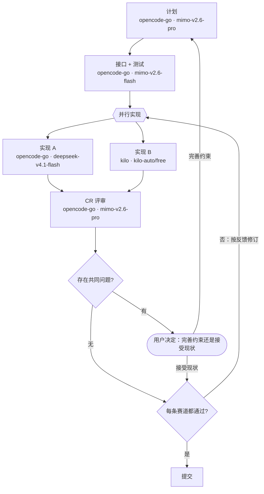

# dsh-racing-code

> **状态：v0.2.0，已实现并装入本机 profile（`web`）。** 零依赖、零构建、宿主半 + 纯函数层，96 个测试全绿；
> 新增**新项目首次引导**（bootstrap，见 §5 小节「新项目引导」）。
> 安装、按 agent 注册段落与工具、段落真的进 prompt、改文件热刷新、改配置热生效、
> "没声明就不启用"都已在真实会话里验过（证据见 [docs/development.md](docs/development.md) §M4）。

**racing = 同一赛段，多个模型同时跑，各自一条赛道；CR 当裁判，把意见发回赛道改到通过为止。**

**每个项目自己写一份流程 markdown**（里面用 mermaid 画工作流程，节点标签上直接写这个阶段用哪个模型）；
插件解析它，把流程图注入该会话的系统提示，让主会话按图执行。
**没有全局流程，也没有内置兜底**——项目里没有这份文件，插件在这个项目里就**保持沉默**（不注入段落、
不注册 `flow_stages`；唯一痕迹是用户显式启动引导时的 `racing_code_init` 工具，见 §5）。

```text
<你的项目>/docs/racing-code.md      ← 唯一来源：阶段、顺序、并行赛道、分支、复盘轮、每阶段模型
（没有这份文件 = 没有流程，插件不注入任何东西，只留引导工具 racing_code_init）
```

### 最小上手

```bash
# 1) 装插件（本机已装：profile 的 dsh.profile.bundles 里有 dsh-racing-code）
plugin_manager  install_bundle  /home/liumenghan/dsh-racing-code

# 2) 在要用流程的项目里放一份流程图；本仓库自己那份可以直接抄
mkdir -p docs && cp /home/liumenghan/dsh-racing-code/main/docs/racing-code.md docs/racing-code.md
#    也可以直接对编排者说：给这个项目启动 racing-code（生成模板 → 确认流程 → 逐节点选模型）

# 3) 会话里问一下现在生效的是什么（只读、现读现算）
#    编排者会调 flow_stages，或直接读系统提示里的流程段落
```

装完**什么都不配是不生效的**——直到某个项目声明了自己的流程（这是刻意的：见 §3）。
引导时在选项卡上选中的路由如果还不在白名单里，**插件会替你追加**（只追加、新会话生效）；
其余情况仍要手工加进 `Settings → Plugins → Subagent delegation`，插件会在会话里告诉你缺哪一条。

格式与语义见 [docs/workflow-format.md](docs/workflow-format.md)，设计依据见 [docs/architecture.md](docs/architecture.md)。

---

## 1. 它解决什么

| | 现在（原生能力） | 装上 dsh-racing-code 之后 |
|---|---|---|
| 项目之间的流程差异 | 只能靠一段"你按 TDD 做"的文字说明，模型看了不一定照做 | **每个项目一份 markdown**，各写各的流程 |
| 阶段有哪些、什么顺序 | 没有"阶段"概念 | mermaid 图里的节点与边就是阶段与顺序 |
| 一个阶段只由一个模型做 | 只能指定一个模型 | **并行赛道**：同一阶段 N 个模型、N 个 worktree，独立各做一版 |
| 谁更好、好在哪 | 没有比较，先做完的说了算 | **CR 评审阶段**逐条打分、列问题 |
| 改到过关 | 要么人盯着逐条提意见，要么不了了之 | **复盘轮**：CR 把每条赛道自己的问题发回**那条赛道的模型**，在原 worktree/原分支上改，复评到**全部通过才定胜负**（轮次有上限） |
| 反复踩同一个坑 | 靠人发现"怎么又错了" | **共同问题 → 约束缺口**：两条赛道都错同一处时，不让他们各自绕过，而是问你要不要改约束 |
| 分支与循环（"红了回实现"） | 全靠散文描述 | 图里的条件边、回边、用户关口 |
| 每阶段用什么模型 | 只能配"子代理允许用哪些模型" | 就写在图里（或同一份文件的 front-matter） |
| 改一次要动什么 | 改全局配置 / 重启会话 | 改**项目里那个 markdown**，**下一个模型步**生效 |
| 是否真的按图执行 | 无保证 | 宿主半按 agent 注入流程段落，`flow_stages` 给出精确路由、赛道与汇合点 |

官方那条"允许子代理使用哪些模型"的白名单**仍然是硬约束**：真正委派时路由必须在白名单内，否则会被 DSH 拒绝。
区别在于现在**有两条路进白名单**：引导（§5）时在选项卡上选中未授权路由，插件替你追加（只追加、新会话生效）；
会话期仍会把未授权的路由标出来并告诉你缺哪一条、加到哪里。

## 2. 为什么叫 racing

| 隐喻 | 对应到系统里 |
|---|---|
| 赛道（lane） | 图上**并行组节点** `{{…}}` 的每条出边：各自在自己的 git worktree 里、用不同模型独立完成同一件事 |
| 发车 | 编排者在**同一条消息**里把所有 lane 同时发起，不是一条条排队；每个阶段节点的子代理显示名是 `<节点词干>-<model>`（如 `implement-deepseek-v4.1-flash`），一眼看出谁在跑哪个模型 |
| 物理隔离 | 每条 lane 一个 `git worktree` + 独立分支（`<workBranch>-racing/<lane-id>`；没有工作分支时是 `racing/<lane-id>`），互不覆盖。目录默认 `<项目根>/.worktrees/<lane-id>`；流程文件写 `laneDir: branch` 时**目录 = 分支名**（如 `0.0.x-racing/implement-a`），与"每个分支一个目录"的容器布局一致 |
| 裁判（CR） | 所有赛道汇聚到**评审阶段**，在同一标准下逐条打分、列问题 |
| 复盘轮 | CR 把**每条赛道自己的问题**发回**那条赛道原来的模型**（`send_message` 给同一个子代理），在原 worktree、原分支上改，提交后复评；**改到每条赛道都没问题，那一轮才给出胜者**；轮次上限 `maxReviewRounds`（默认 2），超限停下问你 |
| 最有价值的信号 | **共同问题**：≥2 条赛道都犯的同一类问题 ≈ 约束有歧义/有缺口。让它们各自绕过只会把规格问题伪装成风格差异，所以**不走赛道修订**，而是停下问你 |
| 用户关口 | "完善约束后重跑" 还是 "接受现状"（接受的问题进"已接受清单"，后续轮次不再当阻塞项） |
| 独立性 | lane 之间**永不互相看**：反馈按赛道切分，只给该赛道自己的问题，不含另一条赛道的问题与评分对比 |
| 定风翼 | 契约与测试**只定一次**（`contract-tests`），所有赛道实现同一份契约——否则比较没有意义 |

## 3. 启用条件与唯一来源

| 情况 | 插件行为 |
|---|---|
| 项目里**没有** `docs/racing-code.md` | **沉默**：不注入段落、不注册 `flow_stages`；只有用户明确说「启动 racing-code」时才出现 `racing_code_init` 引导工具（`bootstrapEnabled: false` 可全关，见 §5） |
| 文件存在、图能解析 | **启用**：注入流程段落 + 注册 `flow_stages` |
| 文件存在、图写坏了 | **不注入流程**，只注入**一句诊断**（哪个诊断码、改哪里）；`flow_stages` 可查完整诊断，另有 `racing_code_init`（默认只预览，`force` 才覆盖坏文件） |

- 文件名默认 `docs/racing-code.md`；项目用自己的 `.dsh/racing-code.yml` 指路（`projectFlowPath` 只是弃用兜底）；
- **模型也在这份文件里**：节点标签第二行（`"实现 A<br/>opencode-go · deepseek-v4.1-flash"`）
  或 front-matter 的 `models:`——两处等价、图内优先。所以"这个项目怎么干活"是**一个文件、一次提交、一份 review**；
- **升级插件不会改变任何项目的流程**（流程只随项目文件走）；
- 启用状态在**会话创建时**判定：中途新建文件要新开会话才启用；中途删除则当前会话退化为一句诊断。

**为什么没有全局层**：一张全局流程表会让"项目之间的差异"退化成最大公约数；一个内置兜底流程会让没写流程的项目
也被塞进别人定的阶段里；两者还都要配一套"哪层赢了"的规则与诊断。所以只有一层，判据很干脆：
**声明了就按它跑，没声明就不跑。**

## 4. 流程文件长什么样

````markdown
---
racing-code: 1
maxLanes: 4
maxReviewRounds: 2
models:
  commit: kilo/kilo-auto/free            # front-matter 写法（与图内标注等价）
---

# 我们的流程



## 阶段说明

### implement-a
按 contract-tests 定下的契约实现，让测试转绿。产出：diff + 测试输出。
````

四种节点由**形状**决定（[完整语法与语义](docs/workflow-format.md)）：

| 形状 | 类型 | 谁执行 |
|---|---|---|
| `id["名称<br/>provider · model"]` | **阶段** | 声明了模型就委派一个子代理，没声明就在当前会话直接执行；标签第二行（可选）就是它的模型 |
| `id{{"名称"}}` | **并行组（赛段）** | 不是阶段：它的每条出边开一条 **lane** |
| `id{"问题"}` | **判定** | 模型给建议与依据、**用户**下判断（`ask_user_question`） |
| `id(["名称"])` | **用户关口** | **用户**下结论；出边的条件文字就是给用户的选项 |

- 有回边的图要写一行 `%% entry: <节点 id>` 指明入口（候选不唯一又不写会报 `FLOW_AMBIGUOUS_ENTRY`）；
- 回边 = 重跑：指向**阶段**就是重跑该阶段（`maxStageRepeats`，默认 3），指向**并行组**就是**开新一轮复盘**
  （`maxReviewRounds`，默认 2）；两者超限都停下问你；
- `### <阶段 id>` 小节是该阶段的**委派提示词骨架**，由 `flow_stages` 按需返回；
- 文件的其余部分是自由正文，写给人看、不进提示词——所以这份 markdown 同时也是项目的流程文档；
- **lane 的隔离是硬约束**：目录由 front-matter 的 `laneDir` 决定（默认 `<项目根>/.worktrees/<lane-id>`；
  `laneDir: branch` 时为 `<项目根>/<workBranch>-racing/<lane-id>`，即目录 = 分支名）+ 分支
  `<workBranch>-racing/<lane-id>`（没写 `workBranch` 时退回 `racing/<lane-id>`），跨轮**复用**
  （同一个 worktree、同一个分支、同一个模型；"轮次"不是"新赛道"）。子代理没有 cwd 参数，
  所以 lane 的提示词里必须写死 worktree 的绝对路径（模板见规范 §11）。

## 5. 起步流程（示例）与本仓库自己的流程

下面这份"两条赛道 + CR 复盘轮"是最小可用形态；本仓库自己也在用
（[docs/racing-code.md](docs/racing-code.md)，多了"设计定稿"这一道用户关口）：

| 阶段 | 做什么 | 示例路由 |
|---|---|---|
| `plan` | 出方案、定验收标准；按 `laneDir` 确认赛道目录策略（默认 `.worktrees` 要写进 `.gitignore`；`branch` 模式不用） | `opencode-go` · `mimo-v2.6-pro` |
| `contract-tests` | 写签名与契约注释、按契约写测试、跑一次确认**红**（**所有赛道的共同标准**） | `opencode-go` · `mimo-v2.6-flash` ⁽¹⁾ |
| `race{{并行实现}}` | **并行组**（不是阶段、不需要路由）：同时发两条赛道 | — |
| `implement-a` | 赛道 1：在自己的 worktree 里实现到绿 | `opencode-go` · `deepseek-v4.1-flash` |
| `implement-b` | 赛道 2：同一契约、另一个模型、另一个 worktree | `kilo` · `kilo-auto/free` |
| `cr` | 逐轮评审：每 lane 评分/问题 → **单赛道问题发回该赛道**、**共同问题问用户** → 全部通过那轮给胜者；**都通过且无明显问题时，改动少的胜出** | `opencode-go` · `mimo-v2.6-pro` |
| `common` / `verdict` | 两个判定：有没有共同问题？每条赛道都通过了吗？ | — |
| `gate`（用户关口） | 有共同问题时问用户：完善约束重跑 / 接受现状 | — |
| `commit` | 提交胜者；清理落败 worktree，**保留分支** | `kilo` · `kilo-auto/free` |

⁽¹⁾ 这里曾临时用 `glm-5.3-flash`：`mimo-v2.6-flash` 在 2026-10-17 的实测里对流式请求一律回
`[model_coming_soon]`，而 DSH 只能流式。**2026-10-18 复测已放行（流式 200）**，示例改回 `mimo-v2.6-flash`；
两次实测都记在 [docs/compatibility.md](docs/compatibility.md) §2.1。

常见调整：加第三条赛道（并行组再加一条出边 + 一个阶段，`maxLanes` 默认容得下 4 条）；把 CR 换更贵的模型；
加严/放宽复盘轮；加"发布"关口。**换模型只改标签或 front-matter，不用动结构。**

### 新项目引导（bootstrap，v0.2.0）

项目还没有流程文件时插件**保持沉默**，但你可以直接对编排者说「**给这个项目启动 racing-code**」：
它会调 `racing_code_init`（描述首句写死：仅当用户明确要求为本项目建立流程时调用；默认只预览、不写盘），
**三步**走完**两次用户介入**：

1. **预览**（`write: false`）：返回结构预览——mermaid 图 + 阶段清单 + 首次清单 + 前置检查 `plan`
   + 逐节点选项 `nodes` + 九步 protocol；**所有阶段模型一律渲染成 `session`**，让结构先成为焦点；
2. **两次介入**：① **确认流程**（预设 `full` / `minimal`、lane 数、阶段说明都可改）；
   ② **逐节点确认模型**（选项卡：`用当前会话模型（默认）` + **DSH llm 目录全量**的候选，目录原序；不在白名单里的标"未授权（选中后自动加入白名单）"，选中后由工具追加进白名单；**赛道必选**）；
3. **写盘**（`write: true`）：写前 `resolveFlow` 0-error 自校验，默认 `createIfAbsent`（已存在不覆盖，
   `force` 才走 `replaceIfVersion`）；赛道缺选拒写 `BOOTSTRAP_CHOICE_REQUIRED`，`plan` 有 blocked 拒写
   `BOOTSTRAP_PLAN_BLOCKED` → **新开会话**才生效（`BOOTSTRAP_RESTART_REQUIRED`）。

**阶段按声明分流**：声明了模型才委派子代理，没声明（`session`/缺键）就在当前会话直接执行；
**lane 永远委派**（lane 选 `session` = 子代理继承会话模型）；`commit` 委派是因为配置里声明了模型。
**`session` 哨兵**：模型表里显式写 `plan: session` = 用户**已选定**"不声明模型"（`routeSource: 'session'`）
——非 lane 阶段在当前会话直接执行、lane 委派时用当前会话模型——**不报** `FLOW_ROUTE_MISSING`，只有**缺键**才报。
**`auto` 哨兵**：模型表里写 `commit: auto` = 该阶段**委派**、但路由不写进文件——会话初始化时从 **DSH 的 llm 目录 ∩ 子代理白名单**（目录原序）按声明顺序分配第一个未占用的路由（`routeSource: 'runtime'`，段落里标 `（运行时解析）`）；**赛道缺键 = `auto`**。
池耗尽或目录不可读 → `FLOW_ROUTE_UNRESOLVED`（warn）+ 退回会话模型；声明的路由不在池里 → `FLOW_ROUTE_UNAVAILABLE`（warn）后按 `auto` 参与分配（模型下线可自愈）。运行时解析**不写白名单**。
写入安全要点：目标钉死项目的流程路径、越根拒绝、坏文本不落盘（自校验 0 error）、默认只预览、
覆盖必须显式 `force`。细节见 [docs/bootstrap.md](docs/bootstrap.md)。

## 6. 配置项

行 id / 设置命名空间都是 `racing-code`。**没有设置页**（§7），所以这些字段直接写在 profile 补丁
`racing-code` 行的 `config` 里（默认值随 bundle 补丁发布）：

| 字段 | 类型 | 默认 | 说明 |
|---|---|---|---|
| `enabled` | boolean | `true` | 总开关（想临时全关时用） |
| `bootstrapEnabled` | boolean | `true` | 新项目引导总开关：false 时连"没文件"也**完全沉默**（不注册 `racing_code_init`） |
| `projectFlowPath` | string | `docs/racing-code.md` | 弃用兜底；优先项目内 `.dsh/racing-code.yml` 的 `flowPath` |
| `workBranch` | string | （无） | 赛道名前缀的全局兜底（`""` 关闭前缀）；项目配置与流程 front-matter 优先 |
| `maxStageRepeats` | number | `3` | 回边护栏默认值（可被 front-matter 覆盖） |
| `maxLanes` | number | `4` | 一个并行赛段最多几条 lane（可被 front-matter 覆盖） |
| `maxReviewRounds` | number | `2` | 最多几轮"CR 反馈 → 赛道修订"（可被 front-matter 覆盖） |

项目内覆盖写 `<会话 cwd>/.dsh/racing-code.yml`（可选；未知键忽略）：`flowPath`、`workBranch`、
`enabled`、`bootstrapEnabled` 与三个护栏。优先级：流程 front-matter > 项目配置 > 上表的全局字段
（全局 `enabled: false` 仍是硬总开关）。

## 7. 为什么没有设置页

前一版的 GUI 页面存在的唯一理由是"编辑全局阶段表 / 路由表"。全局层取消之后，没有任何宿主侧状态需要编辑：
流程与模型都在项目文件里，那是编辑器和模型的主场。于是客户端半区（`dsh.client`、手写 bundle、locale、
表单服务、模型目录下拉、插件自有 HTTP 路由）**整体删除**——插件只剩宿主半 + 纯函数 + 取源。

白名单仍需最终落在内置的 **Settings → Plugins → Subagent delegation** 页里：引导时选中的未授权路由由插件
**自动追加**（只追加、新会话生效），其余情况插件只明确告诉你缺哪一条，不替你写。

## 8. 运行时到底发生什么

1. 会话创建时，宿主半拿 `agent.session.header.cwd`（项目根），读 `<项目根>/docs/racing-code.md`：
   没有 → **保持沉默**（只注册 `racing_code_init` 引导工具，见 §5）；有 → 解析图、合并路由（图内标注 > front-matter > 当前会话模型）、
   校验白名单、从 **llm 目录 ∩ 白名单**解析运行时路由（`auto` 与赛道缺键）、查 CR 复用，缓存住（last-known-good）。
2. 启用时，它给这个 root agent 注册一条**系统提示段落**（order 700）：文件路径、紧凑图、每阶段路由
   （未配置/未授权会标出）、执行规则、复盘轮规则；并在**同一个 agent scope** 里注册 `flow_stages` 工具。
   段落是**同步渲染**的，不做 I/O。
3. 编排者照图执行：顺序阶段按**声明**分流——声明了模型才委派（一次前台 `subagent`，显式传
   `provider`/`model`，提示词自包含），没声明就在当前会话直接执行；**lane 永远委派**；`commit`
   委派是因为配置里声明了模型。进入**并行组**时在一条消息里同时发起所有赛道，每个赛道阶段节点的子代理 `description` 用 `<节点词干>-<model>`（逐节点；`flow_stages` 的「子代理显示名」行可照抄），等它们全部结束才走汇合点。
4. 每条赛道在自己的 worktree 里跑，做完提交到自己的分支；CR 读所有 worktree、逐条评审，
   分诊出"单赛道问题"与"共同问题"，并把共同问题追到"哪条约束没说清"。
5. **复盘轮**：单赛道问题按赛道切分后 `send_message` 发回**该赛道原来的子代理**，它在原 worktree、
   原分支上修订并提交；只有被点名的赛道重跑。CR 复评只看本轮新增 diff，**直到每条赛道都没问题**，
   那一轮才给出胜者并进 `commit`（超过 `maxReviewRounds` 则停下问你）。
6. 共同问题 → 走用户关口（`ask_user_question`，选项就是图上那两条边）；选"接受现状"的问题进入
   已接受清单，后续轮次不再当阻塞项。
7. `flow_stages` 按需给出精确路由、赛道/汇合点、回边与轮次、阶段提示词骨架，以及一张**渲染好的
   "带模型的 mermaid 图"**（可以直接贴给用户或贴进文档）。
8. 改项目里的流程文件 → **下一个模型步**生效；新建/删除该文件 → 新开会话才改变启用状态；
   白名单改动（含引导时的自动加白）→ 新开会话才生效。

## 9. 安装

```text
plugin_manager  install_bundle  /home/liumenghan/dsh-racing-code
```

**装完什么都不会发生**——直到某个项目声明了自己的流程（或者你显式说「给这个项目启动 racing-code」走引导，见 §5）。要试一下：

```bash
mkdir -p docs && cp <本仓库>/docs/racing-code.md docs/racing-code.md    # 或者自己写一份
```

前置条件（本次已写入 `~/.dsh/profiles/web/cordis.patch.yml`，并用 `dsh --profile web --dump-config` 核对）：

- `opencode-go` 模型清单已加入 `mimo-v2.6-pro`；
- `kilo` 路由改用两个静态头（`x-api-key: FREE` + `authorization: Bearer`）而不是 `apiKeyEnv`：kilo 免费档
  只认 `x-api-key`、并且**拒绝**任何真 bearer（401），而 pi-ai 又不允许完全无凭据的路由；
- `subagent-model-selection-settings` 已 `enabled: true`——**图上用到的每条路由都要在这里的
  `allowedModels` 里**（手动加；插件不再自动并入）；
- `standard` / `ptc` 两个 preset 的委派工具本来就带 `modelSelectionSettings: true`，无需改动。

五条**已用真实子代理调用跑通**的路由（不是只看目录）：`mimo-v2.6-pro` ✅、`mimo-v2.6-flash` ✅、
`glm-5.3-flash` ✅、`deepseek-v4.1-flash` ✅、`kilo · kilo-auto/free` ✅。

## 10. 目录

**本仓库自己的布局是"worktree 容器"**：项目目录不是仓库工作区，而是装着裸仓库与各分支 worktree 的容器。

```text
/home/liumenghan/dsh-racing-code/       ← 项目目录 = 容器（git 命令能用，但没有工作区）
├── .bare/                              裸仓库：对象 / refs / origin
├── .git                                文件，内容 gitdir: ./.bare
└── main/                               分支 main 的 worktree（下面这份树就在它里面）
    ├── package.json                    # dsh.bundle.patch（**没有** dsh.client：本插件没有浏览器半）
    ├── cordis.patch.yml                # 插入宿主行 racing-code（含 §6 的默认值）
    ├── lib/
    │   ├── index.js                    # 宿主半：Config（~standard）、按 agent 注册段落与工具（含 racing_code_init）、缓存/热刷新/teardown
    │   ├── flow.js                     # 纯函数：YAML/mermaid 子集解析、图校验、lane/join、回边、路由合并、渲染、诊断
    │   ├── bootstrap.js                # 引导纯函数：full/minimal 模板、逐节点选项、前置 plan、九步协议
    │   └── sources.js                  # 取源：读项目流程图、启用判定（disabled/missing/unreadable/invalid/ok）、fs.watch
    ├── locale/                         # 插件卡片标题/描述（zh + en）
    ├── docs/
    │   ├── racing-code.md              # 本仓库自己的流程（唯一来源的活样例）
    │   ├── bootstrap.md                # 新项目引导：设计与施工图（v0.2.0）
    │   ├── workflow-format.md          # 流程文件格式规范（唯一权威）
    │   ├── architecture.md             # 维护者视角：为什么长这样、扩展点依据、数据流
    │   ├── compatibility.md            # 依赖的官方契约清单与失效症状
    │   └── development.md              # 开发计划：里程碑、接口契约、验收、实测证据、风险
    ├── test/                           # node --test：flow / sources / bootstrap / host / package 五组，96 个用例
    ├── README.md                       # 英文
    └── README.zh.md                    # 本文
```

两条由这个布局带来的约定：

1. **工作区命令在 `main/` 里跑**（`git -C main status`、`npm test` 要用 `main/` 的绝对路径）；
   容器根只做"整仓"操作：`git worktree list` / `git fetch` / `git branch`。容器根不是工作区，
   所以 `git status` 在那里会报 `must be run in a work tree`——这是预期的。
2. **流程文件在被跟踪的 `0.0.x/docs/racing-code.md`**，而会话的 cwd 是容器根，所以由项目自己的配置指路
   （不再需要全局 profile 路径）：

   ```yaml
   # /home/liumenghan/dsh-racing-code/.dsh/racing-code.yml
   racing-code: 1
   flowPath: 0.0.x/docs/racing-code.md
   workBranch: 0.0.x
   ```

   车道目录也跟着这个布局走：本仓库的流程图写了 `laneDir: branch`，所以两条赛道分别落在
   `0.0.x-racing/implement-a/`、`0.0.x-racing/implement-b/`，与 `0.0.x/` 同级——**目录名就是分支名**。
   普通仓库（会话 cwd 就是工作区）保持默认 `.worktrees/` 即可，记得把它写进 `.gitignore`。

   插件包本身也**从 `main/` 安装**（`install_bundle /home/liumenghan/dsh-racing-code/main`），
   因为 `package.json` 在 worktree 里；这属于"插件在自己的仓库里被开发"的必然结果——
   换 worktree 改插件代码后要重新安装指向新目录，并**重启 dsh** 加载新一代模块。

## 11. 文档索引

| 文档 | 给谁看 |
|---|---|
| [docs/workflow-format.md](docs/workflow-format.md) | 写流程的人：mermaid 子集、并行赛道/汇合、用户关口、图内模型标注、诊断码、执行语义 |
| [docs/racing-code.md](docs/racing-code.md) | 本仓库自己的流程（示例 + 抄写起点） |
| [docs/architecture.md](docs/architecture.md) | 维护者：设计依据、宿主半职责、赛道与 CR、失败模式、决策记录 |
| [docs/compatibility.md](docs/compatibility.md) | 维护者：我们依赖哪些官方契约、怎么核实的、失效时什么症状 |
| [docs/development.md](docs/development.md) | 实现者与维护者：里程碑、接口契约、验收标准、**真实会话里的实测证据**、风险清单 |

## 12. 未决问题

1. **要不要确定性的执行器？** v1 是"编排者照图执行"（人在每阶段之间可以看到、可以插话）。
   v2 的 `run_flow` 可以让插件按图驱动子代理；官方 `tool-ralph` 是现成先例（"an ordinary plugin over
   `ctx.workflowEngine` and `ctx.subagents`"），可以把图编译成 workflow 脚本。
2. **护栏要不要硬？** `maxStageRepeats` / `maxLanes` / `maxReviewRounds` 现在只是提示词规则。
3. **CR 之后要不要"取长补短"？** 现在是"反馈改到全部通过 → 选胜者 + 保留落败分支供人挑取"。
4. **落败 worktree 谁清理？** 现在是 `commit` 阶段清理目录、保留分支。
5. **复盘轮要不要逐赛道独立收敛？** 现在是"一条不通过就整轮再评（只重跑被点名的赛道）"。
