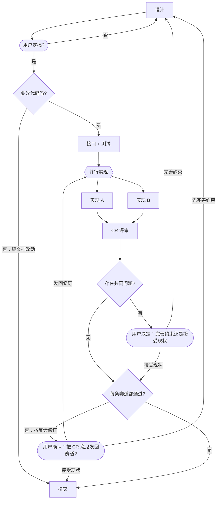

# dsh-racing-code 自己的工作流程

这份文件就是这个项目的"每项目一份流程 markdown"：本仓库的会话里，编排者按下面这张图推进任务；
每个阶段用哪个模型见 front-matter（也可用 `flow_stages` 工具查）。
**声明了模型**（front-matter 或图内标注写了 `provider/model`）的阶段才委派子代理；**未声明**（`session` 或缺键）的**在当前会话直接执行**；赛道（lane）结构上永远委派（lane 选 `session` = 子代理继承会话模型）。**没有按阶段命名的例外**——`commit` 委派是因为配置里给它声明了 `kilo/kilo-auto/free`。

写代码之前先用文档把设计说清楚（**设计不写代码**），设计被用户明确确认后才进入实现；
实现阶段**两个模型各开一条赛道**（各自一个 git worktree，子代理显示名 = `<节点词干>-<model>`），CR 逐轮把各自的问题发回对应赛道
（**发回之前先由用户确认**：图上 `confirm` 关口），**改到每条赛道都通过才定胜负、提交**。

**判定与用户关口语义相同**：执行方先给**建议与依据**，再用 `ask_user_question` 让**用户**下判断（选项=出边文字）；提问前先把**完整材料**发出来（问题清单逐条、diff 摘要、建议），等待给足（≥10 分钟）。

**纯文档改动不走赛道**：定稿后由 `要改代码吗?` 判定——只改文档（README / `doc/*.md`）就直接收口提交，
不写契约测试、不开赛道（那两样对文档没有可比性）。

格式与语义见 [workflow-format.md](workflow-format.md)——本文件同时也是该格式的一个实例。

---

## 阶段说明

### design

**在当前会话直接执行**（路由 session，不委派子代理）。

产出**设计文档**，不写代码：

- 改 `README.zh.md` / `README.md` / `doc/*.md`，必要时新增文档；
- 每个设计决策都要写清"为什么这样选、代价是什么、失效时什么症状"；
- 决策点若有两个以上合理选项，先问用户，不要替用户拍板；
- 产出：diff + 一段"改了什么、还留了哪些未决问题"的汇报。

### contract-tests

**在当前会话直接执行**（路由 session，不委派子代理）。

先定接口与契约，再写测试，**这一步不写实现**，而且**这一步的产物是两条赛道的共同标准**：

- 在 `lib/*.js` 里写下导出签名与 JSDoc 契约（可以是抛 `not implemented` 的骨架）；
- 赛道在 `/home/liumenghan/dsh-racing-code/racing/<lane-id>`（分支名即目录名，见 front-matter 的 `laneDir: branch`）；
- 在 `test/*.test.mjs` 里按契约写用例（`node --test`），覆盖正常路径与失败路径；
- 跑一次 `npm test`，确认**红**，并把红的输出贴进汇报；
- 测试定稿后**赛道不得修改**；契约本身有问题就停下来说明，回到 `design`。

### implement-a / implement-b

两条**并行**赛道，同一份契约、不同模型，互不干扰：

- 只有你的 worktree 是你的：`/home/liumenghan/dsh-racing-code/racing/implement-a`
  （或 `racing/implement-b`），分支 `racing/implement-a`；主工作区（`main/`）别动；
- 所有命令用 `cd <worktree> && …`，文件工具用该目录下的绝对路径；
- 只改 `lib/`，**不得**改 `test/` 里的断言、不得删除用例；
- 不要去看另一条赛道的 worktree：独立作答才有比较价值；
- 发起时 `description` 用 **`<节点词干>-<model>`**（逐节点，照抄 `flow_stages` 的「子代理显示名」行，如 `implement-deepseek-v4.1-flash`），多赛道并行时才认得出谁是谁；
- 产出：diff 摘要 + `npm test` 输出 + 你认为自己没做好的地方；
- 做完把改动提交到自己的分支（message 前缀 `round 1:`）。

### cr

**在当前会话直接执行**（路由 session，不委派子代理）；关口提问带**完整材料 + 建议 + 依据**，等待给足。

逐轮评审两条赛道，并回答"是不是我们的约束没说清"：

1. 对每条 lane：`git -C <worktree> diff`（第 2 轮起只看本轮新增）、读 `lib/` 与 `test/`、
   **在该 worktree 里**跑 `npm test`；
2. 按类归并问题：契约/测试缺口、实现缺陷、约束违背（与 `doc/workflow-format.md` 不一致）、风格；
3. 求**共同问题**：两条赛道都出现的同一类问题；
4. 每条共同问题追一层：**哪条约束没说清**，建议补到哪个文件
   （`doc/workflow-format.md`、`doc/architecture.md`、`AGENTS.md`、或补一条测试）；
5. 有共同问题 → 用 `ask_user_question` 原样反馈，请用户在图上 `gate` 的两个选项里选；
   选"接受现状"记入已接受清单，后续轮次不再当阻塞问题；
6. **把任何意见发回赛道之前，必须走图上 `confirm` 用户关口**（`ask_user_question`，选项就是它的
   三条出边）："发回修订"才继续第 7 步；"先完善约束" → 回 `design`；"接受现状" → 直接进 `commit`。
   **不得未经用户确认就 `send_message` 发回赛道**；
7. **单赛道问题** → 用户确认后按赛道切分，`send_message` 发回该赛道原来的子代理，让它在原 worktree、
   原分支上修订并提交（不要告诉它另一条赛道的问题，也不要给评分对比）；
8. **只有两条赛道都没有阻塞问题时，才给胜者**（评分依据写清）+ 落选赛道值得挑取的地方；
9. 还有一条不通过就回到 `race` 开下一轮；超过 `maxReviewRounds` 仍不通过 → 停下问用户；
10. 只有一条赛道成功时，明确写"共同问题**无法判定**"。

### commit

本阶段在配置里**声明了模型**（`kilo/kilo-auto/free`）→ 委派子代理执行；没声明就在当前会话执行。胜者**合入当前工作分支**（`0.0.x`），**不直接落 `main`**；落败分支保留。

收口与提交：

- **先看这轮有没有赛道**：`要改代码吗?` 走"否"（纯文档改动）就直接收口——不跑契约测试、不看赛道 diff；
  只有在跑过赛道时才适用下面那几条；
- 有赛道时：提交**胜者**那条赛道（`git -C <worktree> …`），落选赛道**不删分支**；
- 有赛道时：看一遍 `git diff`，核对是否严格按"契约测试 → 实现"的顺序发生；
- 收口前跑一遍验证命令（`npm test`、文档链接与诊断码交叉检查等），结果写进汇报；
- 文档若与实现漂移，回到 `design` 阶段补文档（不要在这里偷偷改）；
- 写 commit message：一句话说清"做了什么"，正文列出验证方式与胜者（有赛道时）；
- 有赛道时：提交后清理落选赛道的 worktree 目录（`git worktree remove`，分支保留）；
- 把结果汇报给用户：改了什么、验证结果、胜者与已接受清单（有赛道时）、以及**仓库当前还不是 git 仓库**时
  说明"提交"这一步只做到了收口（等 `git init` 之后再补真正的提交）。
