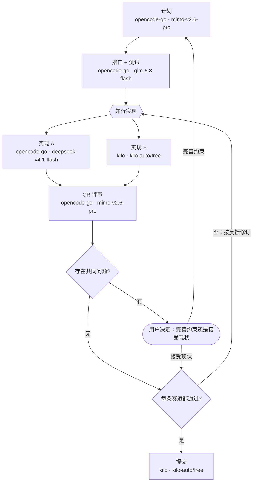
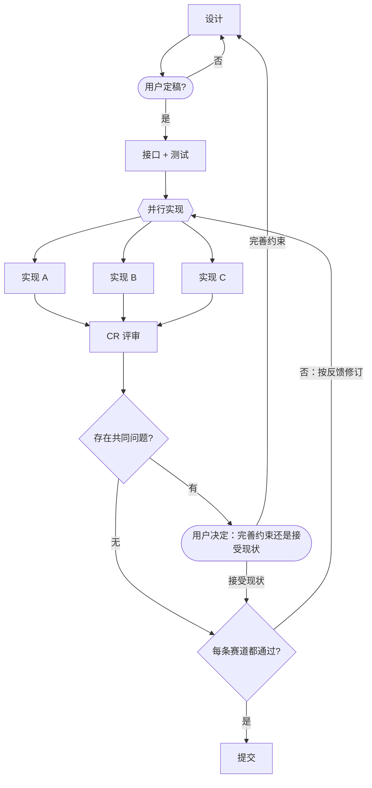

# 流程文件格式（racing-code v1）

一份流程 = **一张 mermaid 流程图**（定义有哪些阶段、什么顺序、哪里并行、哪里分支、哪里回退、哪里复核）
+ **一张模型表**（每个阶段用哪个 provider · model）。
本页是这两样东西的**唯一格式规范**；插件按本页解析，模型按本页书写。

面向两类读者：

- **写流程的人**（每个项目自己的 `doc/racing-code.md`）：看 §2–§6、§10–§12；
- **实现插件的人**：看 §4、§5、§7–§9（解析规则、模型表、诊断码、执行语义）。

设计与依据见 [architecture.md](architecture.md)，依赖的官方契约见 [compatibility.md](compatibility.md)。

---

## 1. 唯一来源：项目里的这份文件

**没有全局流程，也没有内置兜底。** 一个项目的流程只来自
`<项目根>/<Config.projectFlowPath>`（默认 `doc/racing-code.md`），项目根 = `agent.session.header.cwd`
（会话创建时的绝对工作目录）。而**模型表也在这份文件里**——所以"这个项目怎么干活"是**一个文件、一次提交、
一份 review** 的事，不需要在别处再维护一张表。

### 1.1 启用条件：声明了才启用

| 情况 | 插件行为 |
|---|---|
| 项目里**没有**这个文件 | **不启用**：不注入任何段落、不注册 `flow_stages` 工具。会话里看不到 racing-code 的任何痕迹 |
| 文件存在、mermaid 图**能解析** | **启用**：注入流程段落 + 注册 `flow_stages` 工具 |
| 文件存在、图**解析失败** | **不注入流程**，只注入**一句诊断**（哪一行、哪个诊断码、怎么改），并让 `flow_stages` 可查细节。语义上仍是"没启用"，但错误**不静默** |

三条推论：

- **"每个项目都有一个 markdown"是自愿的**：没写就没有流程，插件不会替你决定该有几个阶段；
- **升级插件不会改变任何项目的流程**：流程只随项目文件走；
- **启用状态在 agent 创建时判定**：会话中途新建/删除这个文件，只影响段落文本（见 §9 的
  `FLOW_FILE_MISSING_AFTER_ENABLE`），不会中途注册或注销工具——想让工具消失，新开一个会话。

### 1.2 模型表：同一份文件里的两个地方

| 顺序 | 来源 | 说明 |
|---|---|---|
| 1 | **图内标注**：节点标签第二行 | 最"就地"的写法，图上一眼能看到谁用什么模型（见 §3.2） |
| 2 | 文件的 front-matter `models:` | 等价于往图内标注写一条；适合批量维护、加 `reasoningEffort` |
| 3 | **当前会话的模型** | 两个地方都没有这个阶段 `id` 时兜底：委派**不传** `provider`/`model`，子代理继承父会话模型 |

第 3 条会在当前会话里**明确说出去**：段落与 `flow_stages` 都把该阶段标成
`route: 未配置（用当前会话模型兜底）`，并提示"要固定下来就在图里这个节点的标签第二行写上 provider · model"。
**不会静默**地拿一个看起来像配置的模型去跑。

> 两处是**同一层**：图内标注优先（它就写在那个阶段旁边，改起来最不容易漏）。

---

## 2. 文件骨架

这份流程文件三段组成，后两段可选：

````markdown
---
racing-code: 1                 # 格式版本；省略视为 1，写别的值 → 文件作废并报诊断
maxStageRepeats: 3             # 可选：同一阶段在一轮任务里最多重复几次（回边护栏），默认 3
maxLanes: 4                    # 可选：一个并行赛段最多几条 lane，默认 4
maxReviewRounds: 2             # 可选：评审后最多几轮"反馈 → 赛道修订"，默认 2
laneDir: branch                # 可选：赛道 worktree 放哪；默认 .worktrees，写 branch 表示"目录 = 分支名"
models:                        # 可选：模型表（与图内标注等价，图内优先，见 §7）
  cr: opencode-go/mimo-v2.6-pro
---

# 开发流程

随便写什么说明文字都行；插件只认下面那个 ```mermaid 代码块，其余正文不进提示词。


## 阶段说明

### implement-a

按 `contract-tests` 定下的契约实现，让测试转绿。产出：diff + 测试输出。
````

| 段 | 必需 | 作用 |
|---|---|---|
| front-matter（`---` 之间） | 否 | 版本、三个护栏、模型表 |
| ` ```mermaid ` 代码块 | **是** | 阶段、并行赛段、分支、回退、评审轮、**图内路由标注** |
| `### <阶段 id>` 小节 | 否 | 该阶段的**委派提示词骨架**，由 `flow_stages({stage})` 按需返回 |

阶段说明小节用 `### <id>` 与图里的节点 id 对齐（`##`/`####` 也行，认标题文本等于某个阶段 id 的那一节）。
**文件的其余部分是自由正文**，插件不解析、不进提示词——所以这份 markdown 同时也是项目的流程文档。

---

## 3. 四种节点

插件**不实现 mermaid**，只认下面这个子集。**节点形状决定它是哪一种节点**：

| 形状 | 类型 | 谁执行 | 写法 |
|---|---|---|---|
| `id[名称]` / `id["名称"]` | **阶段** | 委派一个子代理（按模型表给路由） | `implement-a["实现 A"]` |
| `id{{名称}}` / `id{{"名称"}}` | **并行组（赛段）** | 不是一个阶段：它的每条出边开一条 **lane（赛道）** | `race{{"并行实现"}}` |
| `id{问题}` / `id{"问题"}` | **判定** | 与用户关口**同语义**：执行方给建议与依据，**用户**下判断（`ask_user_question`） | `verdict{"每条赛道都通过?"}` |
| `id([名称])` / `id(["名称"])` | **用户关口** | **用户**下结论（必须 `ask_user_question`） | `gate(["用户决定：完善约束还是接受现状"])` |

- `id` 必须匹配 `^[a-z][a-z0-9-]*$`（小写字母开头，可含数字和连字符）。
  大写、下划线、中文 id 都会报 `FLOW_BAD_NODE_ID`。
- 同一个 id 只应定义一次；第二次提到它**只写 id**（再写一次 `["标签"]` 就报 `FLOW_DUPLICATE_NODE`）；
- **形状必须闭合，闭合之后不能有多余文本**：`a["A"] b["B"]` 报 `FLOW_UNPARSABLE_NODE`（一行里的两个节点
  必须用边连接）。这条能抓住"两行粘成一行"这类编辑事故；
- 圆角写法 `id(名称)` 会被当作**阶段**（兼容 mermaid 习惯），但给一条 info 提示：建议改用 `[…]` 或 `([…])`。
- **声明顺序 = 阶段顺序**：节点**首次声明**（带形状那次）的先后即 `flow_stages` 列出的阶段顺序；想让某阶段排最后，让它的声明出现在最后一条边上。
- 图类型与方向：`flowchart TD|TB|LR|RL` 或 `graph …`；方向只影响你自己看图，**不影响语义**。
  其它图类型不支持（`FLOW_UNSUPPORTED_DIAGRAM`）。

### 3.1 阶段节点的标签：名称 + 可选的路由

**阶段**节点的标签是"名称"，可以在 `<br/>` 之后加**第二行写路由**——这样一张图里就看得到"谁在用什么模型"
（下面是两个片段，不是完整图）：

```text
implement-a["实现 A<br/>opencode-go · deepseek-v4.1-flash"]
implement-b["实现 B<br/>kilo · kilo-auto/free"]
```

- 第二行同时接受 `provider · model` 和 `provider/model` 两种分隔；
- **只有第二行匹配 `^[A-Za-z0-9._/-]+\s*[·/]\s*[A-Za-z0-9._/-]+$` 时才当作路由**——
  所以 `["设计 · 第一阶段"]` 这类中文标签仍然只是显示名，不会被误判；
- 路由字符集之外的写法（缺一侧、多个 `·`）→ 当作显示名，不报错；写错模型名则由白名单校验兜住
  （会报"未授权"或"上游不可用"，不会静默）；
- 判定节点、用户关口、并行组的标签**永远只是显示名**（它们不委派、不需要路由）；
- `reasoningEffort` 不写在标签里（写法会歧义），需要时写进 front-matter `models:` 的展开写法。

**渲染产物可以直接贴回来**：图内标注是**输入**（等同于往模型表写一条），插件也能反向**渲染**出一张
带模型的图（把生效路由填进标签，见 `flow_stages` 的 `mermaid` 字段）。渲染出来的标签本身就是合法的图内
标注，所以截图/粘贴回文件是允许的——代价是**那些路由从此固定在该节点上**（不再随 front-matter 变）。
唯一的坑在"看起来像路由、其实不是"：例如 `kilo · kilo-auto/free · high`（多带了一个档位）不会被识别为
路由，而实际生效的路由又来自别处，那时插件会报 `FLOW_LABEL_ROUTE_SHADOWED`（见 §7.2）。

## 4. 边的语义

**出发点的种类决定它的出边怎么解释**——这是整份规范里最关键的一条。

| 出发点 | 出边形态 | 语义 |
|---|---|---|
| 阶段 | 0 条 | **终点**（本轮任务在这里收口） |
| 阶段 | 1 条无条件 | **顺序推进** |
| 阶段 | ≥1 条带条件（无条件边 ≤1 条） | **分支**：选一条；那条无条件边是默认分支 |
| 阶段 | ≥2 条无条件 | `FLOW_STAGE_FANOUT_NOT_GROUP`：**并行必须写成并行组节点** `{{…}}`，否则读图的人无法区分"两条并行赛道"和"两条都要走" |
| 并行组 | ≥2 条**无条件** | **扇出**：每条代表一条 lane 的入口 |
| 并行组 | 1 条 | `FLOW_GROUP_NEEDS_TWO_LANES` |
| 并行组 | 有带条件的出边 | `FLOW_GROUP_LABELED_EDGE`（组只负责发车，不负责选路） |
| 判定 | ≥1 条带条件（可含 1 条无条件作默认） | **分支** |
| 判定 | 没有出边 | `FLOW_DECISION_DEAD_END` |
| 用户关口 | ≥1 条带条件；**条件文字就是给用户的选项** | **分支**（结论由用户给） |
| 用户关口 | 有出边没带条件 | `FLOW_DECISION_UNLABELED_EDGE` |

边的写法：

| 写法 | 含义 |
|---|---|
| `A --> B` | 无条件 |
| `A -- "条件" --> B` | 条件边 |
| `A -->\|条件\| B` | 同上，另一种写法 |
| `A -.-> B` / `A ==> B` | 与 `-->` 等价（箭头样式不区分） |
| `A --> B --> C` | 链式，等价于两条边 |

条件文字里可以写中文、空格、`?`、`=`；不要写 `-->`、`|`、换行。
**用户关口的条件文字会原样成为 `ask_user_question` 的选项标签**，所以写得像人能选的一句话。

### 4.1 入口、回边与环

**入口不是"入度为 0 的节点"**——图里一旦有回边（评审回边、返工回边），就没有入度为 0 的节点了。
规范用下面这条可判定的规则：

> **候选入口** = 图中的每个节点；某个节点是**合法入口**，当且仅当同时满足三条：
> ① 从它出发能走遍全图；② 从它做深度优先走查时，**所有回边（指向走查路径上更早节点的边）都带条件**；
> ③ 去掉这些回边后，它是剩下的 DAG 里**唯一**没有入边的节点。

**有回边的图往往有多个合法入口**（例如"从评审关口开始"也能绕一整圈），所以：

1. 想明确指定入口，就在 mermaid 块里写一行指令（mermaid 自己的注释语法，不影响渲染）：
   `%% entry: <节点 id>`；
2. 不写指令时用上面的规则自动判定：**恰好一个**候选就用它；
   **不止一个** → `FLOW_AMBIGUOUS_ENTRY`（错误，诊断里列出所有候选，让作者补 `%% entry:` 指令）；
   **一个都没有** → `FLOW_NO_ENTRY`；指令写的节点自己不合法 → `FLOW_BAD_ENTRY`。

- 回边**必须带条件**（`FLOW_UNLABELED_BACK_EDGE`）——无条件回边等于静默死循环；
- 走查结束后如果还存在**不是回边构成的环** → `FLOW_CYCLE_WITHOUT_ORDER`；
- 回边的语义：目标是**阶段** → 重跑该阶段；目标是**并行组** → **开新一轮**（§5.2）。

## 5. 并行赛段（racing 的核心）

```
                          ┌─ implement-a（模型 1，worktree A）─┐
contract-tests ──► race ──┤                                    ├──► cr（汇合点）
                   {{…}}  └─ implement-b（模型 2，worktree B）─┘
                    并行组                                            ▲
                      ▲                                               │
                      └───────── verdict -- "否：按反馈修订" ──────────┘
```

- **并行组**：`{{…}}` 节点，它的每条无条件出边开一条 lane；组节点本身**不委派、不占路由**；
- **lane（赛道）**：从组的某个后继出发、到**汇合点**为止的那条**直线**路径；
  **lane 的名字 = 这条路径上第一个阶段的 id**（上例是 `implement-a` 与 `implement-b`）；
- **汇合点 J**：所有 lane 都能到达的、**在去掉回边后的 DAG 上**拓扑序最靠前的节点（上例是 `cr`）。找不到 → `FLOW_NO_JOIN`；
- **lane 内可以有多个阶段**（`race --> impl-a1 --> impl-a2` 与 `race --> impl-b1`）：
  同一条 lane 的所有阶段**共享同一个 worktree 与分支**；
- **lane 内部不允许再出现分支或嵌套并行组**（`FLOW_BRANCH_INSIDE_LANE` / `FLOW_NESTED_FANOUT`）：
  阶段内部的迭代（跑测试 → 修 → 再跑）是**子代理自己的事**，不画在图上；
- lane 条数建议 2–4 条（`maxLanes` 默认 4，超出报 `FLOW_TOO_MANY_LANES`）。

### 5.1 worktree 规则（硬约束）

同一赛段的每条 lane **必须在自己的 git worktree 里工作**——这是"多个模型互不干扰地各写一版"的唯一实现方式：

| 项 | 约定 |
|---|---|
| 位置 | 默认 `<项目根>/.worktrees/<lane-id>/`；front-matter 写 `laneDir: branch` 时是 `<项目根>/racing/<lane-id>/`
（目录 = 分支名）；写别的值（如 `laneDir: wt`）就用它当父目录。**一律必须在项目根之下**（见下） |
| 分支 | `racing/<lane-id>` |
| 建立 | 编排者在**开赛前**执行 `git worktree add .worktrees/<lane-id> -b racing/<lane-id>` |
| 子代理怎么进去 | `subagent` 工具**没有 cwd 参数**，子代理继承父会话的 cwd（= 项目根）。所以 lane 的提示词里必须写死绝对路径：所有 bash 用 `cd <worktree> && …`，文件工具用绝对路径 |
| 修订轮 | **复用同一个 worktree、同一个分支、同一个子代理（同一个模型）**，不新建赛道 |
| 每轮收口 | lane 在本轮修订后**提交到自己的分支**，方便 CR 只看"本轮改了什么" |
| 结束 | 比赛期间 worktree **保留**（CR 要读、用户可能要挑取）；`commit` 完成后清理落败 lane 的 worktree（**分支保留**） |
| 清理 | `git worktree remove <path>`；**不得**擅自 `git branch -D` 落败分支 |
| 项目不是 git 仓库 / git 不可用 | **停下问用户**：初始化 git 后重试，或降级为单 lane 顺序实现（不允许悄悄串行） |
| 沙箱为 `read-only` | `git worktree add` 会写 `.git/` 与工作目录，会失败；按沙箱提示**申请一次提权**，或问用户 |

**为什么 worktree 必须在项目根之下**：DSH 的 `workspace-write` 沙箱只允许写**会话工作区（= 项目根）
与平台临时目录**；建在 `../` 或别处会被沙箱拒绝。代价是它会被 `git status` 看到，所以**建议把
`.worktrees/` 加进 `.gitignore`**（由 `plan` 阶段或人来做，插件不写工作区文件）。

### 5.2 评审轮（round）

**一个并行组可以被多次进入**：第一次由上游阶段进入；之后由**回边**（带条件）进入 = **开新一轮**。
一轮的完整过程是"赛道出活 → CR 评审 → 反馈给各赛道 → 赛道修订 → 复评"：

| 概念 | 规则 |
|---|---|
| 一轮的定义 | 从并行组被进入，到 CR 给出结论为止 |
| 轮次上限 | `maxReviewRounds`（默认 2）= 最多几轮"反馈 → 修订"；超限**停下问用户**，不允许无限来回 |
| worktree | 跨轮**复用**（同一 lane、同一分支、同一模型） |
| 只重跑谁 | 再进入赛段时**只重跑被 CR 点名要修的 lane**；没被点名的 lane 必须验证"确实没变"（HEAD 与工作区都干净），CR 下一轮直接沿用上一轮对它的结论 |
| 提交 | 每轮修订后 lane 提交到自己的分支，commit message 带轮次（如 `round 2: 修正边界处理`） |
| 独立性 | **lane 之间永不互相看**：CR 的反馈**按赛道切分**，每条 lane 只收到自己的问题清单（不含另一条 lane 的问题与评分对比）；横向比较只出现在给用户看的 CR 报告里 |

## 6. 声明流程时的常见意图对照

| 你想表达 | 怎么写 |
|---|---|
| A 做完做 B | `a --> b` |
| A 之后二选一（模型/人判断） | 判定节点 + 带条件的出边 |
| A 之后**多个模型同时各做一版** | 并行组节点 `{{…}}` + 每个 lane 一条出边，再汇聚到一个 join 节点 |
| **反复改到评审通过** | 评审阶段 → 判定 →（带条件的）回边指向**并行组**；轮次上限由 `maxReviewRounds` 管 |
| 某步失败要重做 | 带条件的回边（指回更早的阶段） |
| 某一步必须由人拍板 | 用户关口节点（`([…])`），出边文字就是给用户的选项 |
| 子代理内部要跑测试、改到绿 | 不用画：那是这个**阶段自己**的迭代 |

## 7. 模型表

### 7.1 写在同一个文件的两个地方

| 地方 | 语法 | 适合 |
|---|---|---|
| **图内标注** | 阶段节点标签的第二行 `名称<br/>provider · model` | 想让"图上一眼看到谁用什么模型"；改起来离阶段最近 |
| front-matter `models:` | 受限 YAML 子集（下面这张表） | 批量维护、需要 `reasoningEffort`、想按字母对齐 |

两处**同一层**：图内标注优先（见 §1.2）。front-matter 是**受限 YAML 子集**（零依赖手写解析器，
只支持这些；超出范围报 `FLOW_YAML_UNSUPPORTED`）：

| 支持 | 不支持 |
|---|---|
| 注释 `# …` | 数组 `- item` |
| `key: value` | 流式写法 `{a: 1}` / `[1, 2]` |
| 两空格缩进嵌套 | 多行字符串 `\|` `>` |
| 裸串、`"引号串"`、数字、`true/false` | 锚点 `&`/`*`、`---` 文档分隔、多份文档 |

### 7.2 语义

```yaml
# <项目>/doc/racing-code.md 的 front-matter
plan: opencode-go/mimo-v2.6-pro                       # 简写：provider/model
contract-tests: opencode-go/glm-5.3-flash
implement-a: opencode-go/deepseek-v4.1-flash          # 赛道 1
implement-b: kilo/kilo-auto/free                      # 赛道 2
cr:
  provider: opencode-go                               # 展开写法
  model: mimo-v2.6-pro
  reasoningEffort: high                               # 可选，必须是该模型广告的档位
commit: kilo/kilo-auto/free
```

- **按阶段 id 匹配**（lane 也是阶段，所以 lane 各自一条路由——这就是"多个模型分别实现"）；
  **并行组、判定、用户关口不需要路由**；
- 出现图里没有的 id → 只警告 `FLOW_MODEL_UNKNOWN_STAGE`；
- 阶段缺路由 → 用**当前会话模型**兜底 + 在会话里明确提示（§1.2 第 3 条）；
- **关键字 `session`**：显式写 `design: session` = 用户已选「用当前会话模型」（`routeSource: 'session'`），**不报** `FLOW_ROUTE_MISSING`；只有**缺键**才报 missing（漏配 ≠ 显式选择）。
- **CR 的模型不应与任何 lane 相同**（自评会有偏好）：命中就警告 `FLOW_CR_MODEL_REUSED`；
- 路由是否在子代理**白名单**内由插件单独校验：不在 → 标 `未授权`，并在会话里告诉你**缺哪一条、加到哪里**
  （内置 Subagent 设置页）。多条 lane 意味着**白名单至少要有这么多条可用路由**——这条要在开跑前就看到；
- **标签可能"看着像路由但没被识别"**：`flow_stages` 返回的 `mermaid` 是渲染结果，贴回文件是合法的
  （标签就是图内标注），只是那些路由从此固定在该节点上。但如果你手写的第二行**像**路由却不符合
  §3.1 的严格写法（例如 `kilo · kilo-auto/free · high` 多带了一个档位），它不会被当作路由——
  此时若该阶段的路由来自 front-matter，插件会报 `FLOW_LABEL_ROUTE_SHADOWED`（warn），避免"看着是 A、
  跑的是 B"；若哪里都没配路由，则照常按"用当前会话模型"兜底；

## 8. 执行语义

### 8.1 顺序、并行、分支、回边

- 顺序阶段按**声明**分流：模型表里写了 `provider/model` 的阶段 → 一次前台 `subagent`；`session`/未声明的 → **在当前会话直接执行**（不委派）；**lane 永远委派**（lane 选 `session` = 子代理继承会话模型）。**没有按阶段命名的例外**——`commit` 委派，是因为配置里给它声明了模型。
- **代码不得硬编码具体的阶段名或模型名**：阶段与模型只有一个来源——项目声明与用户选择；生成器/渲染层不得按阶段名分支，也不得在文案里点名某个模型。
- **进入并行组**：同一条 assistant 消息里把所有 lane **同时发起**（后台运行），不要一条一条等；
- **汇合点**必须**等所有 lane 结束**（成功或失败）才开始；
- 分支：编排者按判定节点的文字自己下结论（跑测试、看 diff），按条件边选一条，并把
  "判定 = 什么 → 下一阶段 = 谁"写进给用户的汇报里；
- 用户关口/判定：**必须**用 `ask_user_question` 拿结论，出边文字就是选项；执行方先给**建议与依据**（判定=带建议的关口）；**提问前先把完整材料发出来**（问题清单逐条全文、diff 摘要、建议），**等待给足**（≥10 分钟），不许只给统计数字、不许超时掐断；不得替用户决定；
- 回边：同一阶段在一轮任务里的累计次数不得超过 `maxStageRepeats`（默认 3）；**到上限就停下问用户**。

### 8.2 评审轮：反馈给赛道，改到 CR 认为没问题为止

CR 的结论**不是**"选一个赢家"就结束，而是一个闭环：

1. **初审**：CR 逐 lane 评审（读该 worktree 的 diff、关键文件，**在该 worktree 里**跑一次测试）；
2. **分诊**：
   - **共同问题**（≥2 条 lane 的同一类问题）→ 大概率是**约束缺口**，走**用户关口**问用户
     （改约束 → 回到上游重来；接受现状 → 记入"已接受清单"，后续轮次不再把它当阻塞问题）；
   - **单赛道问题** → 反馈给**这条赛道的模型**，让它修；
3. **反馈按赛道切分**：给 lane A 的消息里只有 A 的问题清单，**不含** lane B 的问题、也不含评分对比
   （独立性是横向比较的前提）；同时附上"本轮验收标准"（通常是那条失败的测试命令）；
4. **修订用同一个子代理**：把反馈 `send_message` 发回该 lane **原来的 continuable 子代理**
   （它还记得自己写过什么，比新起一个更省、也更准）；原会话已不可用时才退化为"同 provider/model
   新起一个，并在提示词里带上它自己的 diff 与本轮反馈"；
5. **修订在同一个 worktree**（同一 lane、同一分支、同一模型）里做，做完**提交到该分支**；
6. **复评**：CR 只看被点名的 lane 的**本轮新增 diff**（`git -C <wt> diff <上一轮 HEAD>..HEAD`），
   未被点名的 lane 验证"没变"后沿用上一轮结论；
7. **通过判定**：**每条 lane 都没有阻塞问题时，才由 CR 给出胜者**（评分依据写清楚）并进入 `commit`；
   只要还有一条不通过，就按回边回到并行组开下一轮；
8. **轮次上限**：`maxReviewRounds`（默认 2）轮"反馈 → 修订"之后仍不通过 → **停下问用户**
   （重跑、换模型、放宽验收标准，还是接受现状），不允许无限来回；
9. **只有一条赛道成功**时：按单 lane 评审，并明确写"共同问题**无法判定**"；失败 lane 的原因要原样报告。

### 8.3 CR 报告的结构

给用户看的报告固定包含：每 lane 的评分与问题清单、**共同问题**、每条共同问题追一层
"**哪条约束没说清**、建议补到哪个文件"（流程文件 / `AGENTS.md` / 契约文档 / 补一条测试）、
本轮是否通过、胜者是谁（通过时才给）、以及"已接受清单"里还没修的问题。

**为什么共同问题单独处理**：只有一条 lane 犯的错，是模型能力/风格差异，让那条赛道改就是了；
两条独立赛道从同一份约束出发、独立工作却撞进同一个坑，多半是**约束本身有歧义或有缺口**——
这时候让它们各自绕过去，只会把"规格问题"伪装成"两条实现风格不同"，所以必须先问人。

### 8.4 定胜负与提交

- 胜者 = CR 在**全部赛道都通过**的那一轮给出的更高分者（评分依据要写出来）；
- `commit` 默认提交胜者那条 lane（`git -C <worktree> …` 或把该分支合入）；
- 落败 lane 的 worktree 在提交完成后清理（分支保留），**不得**擅自删除分支或丢弃未提交内容；
- 若用户关口选了"完善约束"，先改约束文件，再按回边回到目标阶段重跑；
  新一轮的 worktree 用新的 lane 目录名（如 `.worktrees/implement-a-2`），避免和上一轮混淆。

---

## 9. 诊断码

**总原则**：任何解析失败都**不允许**让系统提示组装失败，也不允许让会话发不出请求。项目没有声明流程时，
插件**什么都不做**；声明了却坏了，就**只说话不执行**（不注入流程，只注入一句诊断）。

| 码 | 级别 | 触发 | 结果 |
|---|---|---|---|
| `FLOW_FILE_MISSING` | info | 项目里没有这个文件 | **不启用**：不注入段落、不注册工具 |
| `FLOW_FILE_MISSING_AFTER_ENABLE` | warn | 会话中途文件被删/改名 | 段落退化成这一句（不再显示旧流程），工具返回 `not_enabled`；新会话即完全不启用 |
| `FLOW_FILE_UNREADABLE` | error | 文件存在但读不出来（权限/二进制） | 只注入一句诊断 |
| `FLOW_NO_FRONT_MATTER` | info | 没有 `---` 块 | 正常，按默认版本 1 解析 |
| `FLOW_VERSION_UNSUPPORTED` | error | `racing-code` 不是 1 | 文件作废 |
| `FLOW_FENCE_MISSING` | error | 没有 ```mermaid 代码块 | 文件作废（**等于没有声明流程**） |
| `FLOW_MULTIPLE_FENCES` | warn | 有多块 | 只用第一块，并提示 |
| `FLOW_UNSUPPORTED_DIAGRAM` | error | 不是 `flowchart`/`graph` | 文件作废 |
| `FLOW_BAD_NODE_ID` | error | id 不是 slug | 文件作废 |
| `FLOW_DUPLICATE_NODE` | error | 同一 id 定义两次 | 文件作废 |
| `FLOW_ROUND_NODE_DEPRECATED` | info | 用了 `id(名称)` | 当作阶段，建议改 `[…]` |
| `FLOW_NO_ENTRY` | error | 没有任何合法入口（见 §4.1） | 文件作废 |
| `FLOW_AMBIGUOUS_ENTRY` | error | 有多个合法入口且没写 `%% entry:` 指令 | 文件作废；诊断里列出全部候选 |
| `FLOW_BAD_ENTRY` | error | `%% entry:` 指的节点不存在或不是合法入口 | 文件作废 |
| `FLOW_UNREACHABLE_STAGE` | error | 有阶段从入口走不到 | 文件作废 |
| `FLOW_UNLABELED_BACK_EDGE` | error | 回边没写条件 | 文件作废 |
| `FLOW_STAGE_FANOUT_NOT_GROUP` | error | 阶段节点出现 ≥2 条无条件出边 | 文件作废（改为并行组节点） |
| `FLOW_GROUP_NEEDS_TWO_LANES` | error | 并行组只有 1 条出边 | 文件作废 |
| `FLOW_GROUP_LABELED_EDGE` | error | 并行组的出边带了条件 | 文件作废 |
| `FLOW_AMBIGUOUS_FANOUT` | error | 一个阶段既有条件出边、又有 ≥2 条无条件出边 | 文件作废 |
| `FLOW_DECISION_DEAD_END` | error | 判定/用户关口没有出边 | 文件作废 |
| `FLOW_DECISION_UNLABELED_EDGE` | error | 判定/用户关口的出边没写条件 | 文件作废 |
| `FLOW_NO_JOIN` | error | 并行组各条 lane 没有共同汇合点 | 文件作废 |
| `FLOW_NESTED_FANOUT` | error | lane 内部又出现并行组 | 文件作废（v1 不支持嵌套） |
| `FLOW_BRANCH_INSIDE_LANE` | error | lane 内部出现条件分支 | 文件作废（lane 必须是直线） |
| `FLOW_TOO_MANY_LANES` | error | 一个并行组超过 `maxLanes` | 文件作废 |
| `FLOW_CYCLE_WITHOUT_ORDER` | error | 存在非回边构成的环 | 文件作废 |
| `FLOW_UNPARSABLE_EDGE` | error | 认不出的边写法 | 文件作废 |
| `FLOW_UNPARSABLE_NODE` | error | 认不出的节点写法 | 文件作废 |
| `FLOW_YAML_UNSUPPORTED` | error | front-matter 用了子集外的写法 | 文件作废 |
| `FLOW_LANE_DIR_INVALID` | warn | front-matter 的 `laneDir` 不是**单个相对目录名**（空、含 `/` 或 `\`、含 `..`、以 `~` 开头都算非法；关键字 `branch` 合法） | 忽略该值，按默认 `.worktrees` 处理并提示 |
| `FLOW_MODEL_UNKNOWN_STAGE` | warn | 模型表里有图里没有的 id | 忽略该条，提示 |
| `FLOW_ROUTE_MALFORMED` | warn | 某阶段的路由写法不对（既不是 `provider/model`，也不是 `{provider, model}`） | 忽略该条，按"未配置"处理并提示 |
| `FLOW_ROUTE_MISSING` | warn | 某阶段没路由 | 用当前会话模型兜底 + 提示 |
| `FLOW_ROUTE_NOT_AUTHORIZED` | warn | 路由不在子代理白名单 | 标注未授权，并指出缺哪一条、加到哪里 |
| `FLOW_CR_MODEL_REUSED` | warn | CR 的模型与某条 lane 相同 | 提示自评偏好风险，建议换路由 |
| `FLOW_LOOP_WITHOUT_REVIEW` | warn | 回边指回并行组，但该组之后没有评审阶段 | 提示"这样会重新开跑却没人横向比较" |
| `FLOW_LABEL_ROUTE_SHADOWED` | warn | 标签第二行像路由但写法不合法，而实际生效的路由来自 front-matter | 提示"看着是 A、跑的是 B" |
| `FLOW_BACK_EDGE_TARGET` | error | 回边指向了判定或用户关口（只能指向阶段或并行组） | 文件作废 |

`info`/`warn` 只提示；`error` 让文件作废（不启用流程）。诊断的送达位置：
**系统提示段落里一句话** + `flow_stages` 的 `diagnostics[]`（没有 GUI，诊断只走会话）。

`racing_code_init`（引导工具）自己的诊断码走**工具输出**（不在上表；写入安全见 [bootstrap.md](bootstrap.md) §5）：

| 码 | 级别 | 触发 |
|---|---|---|
| `BOOTSTRAP_FILE_EXISTS` | warn | 目标已存在且未 `force` |
| `BOOTSTRAP_TEMPLATE_INVALID` | error | 生成文本自校验没过（生成器红线） |
| `BOOTSTRAP_TARGET_OUTSIDE_ROOT` | error | 目标逃出项目根 |
| `BOOTSTRAP_PARENT_MISSING` / `BOOTSTRAP_PLAN_BLOCKED` | error | 父目录缺失 / plan 含 blocked 项（写前拒写） |
| `BOOTSTRAP_WRITE_CONFLICT` / `BOOTSTRAP_WRITE_FAILED` | warn/error | 版本冲突 / fs 写失败（含沙箱拒绝） |
| `BOOTSTRAP_CHOICE_REQUIRED` | error | write:true 时赛道还没选模型 |
| `BOOTSTRAP_NO_CANDIDATES` / `BOOTSTRAP_CR_REUSE_RISK` | warn | 候选池为空 / CR 自评偏好提示 |
| `BOOTSTRAP_RESTART_REQUIRED` | info | 写入成功，新开会话生效 |

## 10. 写完自查

- [ ] 图里恰好一个起点，所有阶段都能从起点走到；
- [ ] **有回边的图写了 `%% entry: <节点 id>`**（不写时，只要"合法入口"不唯一就会报
  `FLOW_AMBIGUOUS_ENTRY` 并列出候选）；
- [ ] 每个阶段 id 都是 `小写字母开头 + 小写字母/数字/连字符`；
- [ ] 要并行的阶段写成了**并行组节点**，且它们都能走到**同一个**汇合点（通常是 CR）；
- [ ] 每条 lane 的名字（= 它的第一个阶段 id）在模型表里有路由，且**互不相同**；
- [ ] CR 的模型与任何 lane 都不同（避免自评偏好）；
- [ ] 评审回边指向**并行组**（而不是某一条 lane），并且带条件；
- [ ] `maxReviewRounds` 设成了你愿意等的轮数（默认 2）；
- [ ] `laneDir` 与你的布局一致：普通仓库用默认 `.worktrees`（记得加进 `.gitignore`）；
  "项目目录本身是 worktree 容器、每个分支一个目录"的布局用 `laneDir: branch`，此时不需要 ignore 任何东西；
- [ ] 每条 lane 的提示词里都写了"你的 worktree 绝对路径"（模板见 §11）；
- [ ] 有一条明确的"完成"路径（终点阶段），跑完它就算这轮任务结束；
- [ ] 分支/用户关口的条件文字都写得能被回答（"测试全绿?" 而不是 "好不好?"）；
- [ ] 每个阶段要么在模型表里（图内标注或 front-matter）有路由，要么接受"用当前会话模型兜底"；
- [ ] 路由都在子代理白名单里（否则会话里会报"未授权"，缺的那条要先加到内置 Subagent 设置页）。
- [ ] 用引导生成的文件：核对**首次清单**（git/lane 目录、白名单路由、新开会话）都已处理。

## 11. lane 提示词模板（给编排者用）

把模板里的 `<worktree>` 换成 **`flow_stages` 给出的该赛道 worktree 绝对路径**（它的位置由 front-matter 的
`laneDir` 决定：默认 `<项目根>/.worktrees/<lane-id>`，`laneDir: branch` 时是 `<项目根>/racing/<lane-id>`），
`<worktree>` 与分支名一一对应。

**首轮（开赛）**：

```
你在 git worktree <worktree> 里工作（分支 racing/implement-a）。
主工作区 /abs/path 不要改；所有命令用 `cd <worktree> && …`，
文件工具请用该目录下的绝对路径。
任务：<阶段说明>。
约束：契约与测试在 <路径>；**不得修改测试断言**；验收命令 `<命令>`。
产出：diff 摘要 + 验收命令输出 + 你认为没做好的地方。
做完请把改动提交到 racing/implement-a（message 前缀 `round 1:`）。
```

**修订轮（把 CR 的反馈发回同一个子代理）**：

```
CR 第 <N> 轮对你这条赛道的结论是"未通过"，只列你自己的问题（另一条赛道的问题不告诉你，
这是为了让两版保持独立可比）：
1) <问题>
2) <问题>
本轮验收标准：`<失败的命令或断言>`。
请在你的 worktree <worktree> 里修改并提交（message 前缀 `round <N+1>:`），
不要改动主工作区，也不要改测试断言。完成后回报：改了什么 + 验收命令输出。
```

## 12. 完整示例

**最小可用（两条赛道 + CR 评审轮）**——把这段放进 `<项目>/doc/racing-code.md` 就启用了：

````markdown
---
racing-code: 1
maxLanes: 4
maxReviewRounds: 2
---

# 我们的开发流程



## 阶段说明

### cr
逐赛道评审；单赛道问题反馈回该赛道修订，共同问题问用户；**全部赛道通过的那一轮才给胜者**。
````

**更完整一点（三道赛道 + 设计定稿关口 + front-matter 覆盖）**：

````markdown
---
racing-code: 1
maxReviewRounds: 3
models:
  implement-c: opencode-go/glm-5.3-flash        # 第三条赛道用 front-matter 写
  cr:
    provider: opencode-go
    model: mimo-v2.6-pro
    reasoningEffort: high
---

# 我们的流程

设计先由用户定稿；三个模型并行实现；CR 每轮把各自的问题发回对应赛道，改到全部通过才定胜负。


````

本仓库自己的流程文件就是 [racing-code.md](racing-code.md)——它是**这个项目**的流程（不是模板兜底），
可以直接当抄写起点。
