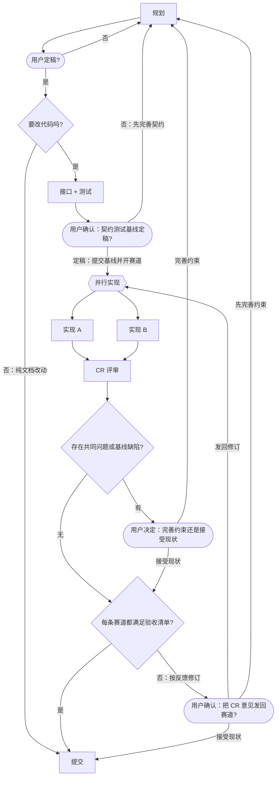

# 新项目引导（bootstrap）：设计与修改方案

> **状态**：设计已按用户的四条决定收敛（2026-10-17）。本文既是设计，也是施工图。**v0.2.0 已实现**（胜者 implement-b 合入 main，`aaef55c`+`408877e`）；e2e 三条待真实新会话实测。
> 读者：contract-tests 阶段据此写契约与测试；两条赛道据此实现；CR 据此判"是否违背约束"。
> 基线：HEAD `0009269`（`laneDir` 已落地），`cd main && npm test` → **69 个用例全绿**。

---

## 0. 用户已定的四条（不可自行更改）

| # | 决定 | 落到实现 |
|---|---|---|
| 1 | 没有流程文件时插件**保持沉默**：不注入任何系统提示文字 | `install()` 在 `missing` 时**不注册段落**；唯一痕迹是工具表里的 `racing_code_init` |
| 2 | 用户**介入两次**：① 确定流程 ② 完整流程确认后，逐一确定每个节点使用的模型 | 工具默认只预览（`write:false`）；两关都过才写盘 |
| 3 | 每个节点的模型由用户在**选项卡**上确定；**非赛道节点默认 = 当前会话模型** | 工具不自动挑模型；front-matter 用 `session` 哨兵表示"显式用会话模型"；赛道模型必须由用户选 |
| 4 | 两次介入都完成之后才写盘 | `write:true` 且赛道缺选择 → 拒写（`BOOTSTRAP_CHOICE_REQUIRED`） |

---

## 1. 现状与缺口（HEAD `0009269`）

- 插件三层：[lib/index.js](../lib/index.js)（宿主半，347 行）、[lib/flow.js](../lib/flow.js)（纯函数，1132 行）、[lib/sources.js](../lib/sources.js)（取源，200 行）；测试 4 个文件。
- [docs/racing-code.md](racing-code.md) 已用 `laneDir: branch` + `workBranch: 0.0.x`（赛道目录 = 分支名 = `0.0.x-racing/<lane-id>`，见 [workflow-format.md](workflow-format.md) §5.1）。
- profile：bundle 从 `/home/liumenghan/dsh-racing-code/main` 链接安装；racing-code 行只留全局默认；项目用 `/home/liumenghan/dsh-racing-code/.dsh/racing-code.yml` 指路。

| 缺口 | 位置/证据 |
|---|---|
| 没文件 → 零注册，用户没有任何入口 | [lib/index.js](../lib/index.js) `install()` 对 `missing/disabled` 直接 return；host 测试 `a project without a flow file registers nothing at all` |
| "新建流程文件入口"悬而未决 | README §12-3、[architecture.md](architecture.md) §12、[development.md](development.md) 未决 |
| "插件只读、不写任何工作区文件"是不变量 | [architecture.md](architecture.md) §10、[compatibility.md](compatibility.md) §1.6 |
| 模型配置靠人抄示例；白名单漏路由要到启用后才发现 | README §5、`FLOW_ROUTE_NOT_AUTHORIZED` |
| 容器布局（`.bare/` + `main/` + `racing/`）没有引导路径 | 本仓库自己的布局；[development.md](development.md) §仓库布局 |

---

## 2. 交互协议（两次介入，九步）

| # | 谁 | 动作 |
|---|---|---|
| 1 | 用户 | 显式指令，唯一触发面："给这个项目启动 racing-code" |
| 2 | 编排者 | `racing_code_init({ write:false })` |
| 3 | 工具 | 返回**结构预览**：mermaid 图 + 阶段清单 + 阶段说明 + 护栏 + 目标路径 + `plan[]`（前置检查）+ `nodes[]`（可选项）+ `protocol[]`（下面这套两步协议原文）。**所有阶段模型一律渲染成 `session`**，让结构成为焦点 |
| 4 | 编排者 | **介入 1**：`ask_user_question` 确认流程（预设 `full/minimal`、lane 数 2/3、阶段说明用词都可改） |
| 5 | 用户 | 「确认流程」或「改结构：…」；改则回 2/3 重新预览，循环到确认 |
| 6 | 编排者 | **介入 2**：按流程顺序（入口→出口，跳过并行组/判定/用户关口）**逐节点**发问 |
| 7 | 用户 | 每个节点一个问题：`用当前会话模型（默认）` + **DSH llm 目录全量**里的候选路由（目录原序，附授权与上游备注；不在白名单里的标"未授权（选中后自动加入白名单）"）。赛道节点必选；CR 那题写明"默认走会话模型，与某条 lane 或写契约基线的阶段相同会有自评偏好（会把自己的基线当地面真值），请避开或单独指定" |
| 8 | 编排者 | 收齐 → `racing_code_init({ models:{…}, write:true })` → 自校验 0 error → `createIfAbsent` 落盘 |
| 9 | 工具/编排者 | 返回计划 + `BOOTSTRAP_RESTART_REQUIRED`：**新开会话**才生效；git / worktree / `.gitignore` 的修复命令由编排者征得用户同意后执行（插件不跑子进程） |

要点：**介入 1 结束前不弹任何模型问题**；"逐一"用一次 `ask_user_question` 调用、每节点一问（恰好两次介入）；若要严格一问一等，改成逐次调用即可，协议文字两种都合规。

---

## 3. 契约（contract-tests 直接落）

### 3.1 工具 `racing_code_init`

```js
// 注册时机：missing/invalid 且 Config.bootstrapEnabled 且 root agent（其余情况不注册）
// 描述首句（写死）："仅当用户明确要求为本项目建立流程时调用；默认只预览、不写盘。"
// 参数
{
  template?: 'full' | 'minimal',            // 默认 'full'
  lanes?: 2 | 3 | 4,                        // 默认 2
  models?: { [stageId]: 'provider/model' | 'session' },  // 只覆盖指定键；缺键 = 未选；显式 session = 用户已选（合法）
  write?: boolean,                          // 默认 false（预览）
  force?: boolean                           // 默认 false；仅 write:true 有效
}
// 输出
{
  summary: string,
  wrote: boolean,
  file: string,                             // 目标绝对路径（= projectFlowPath）
  template: string,                         // 全文（预览与落盘同一份文本）
  nodes: [{ id, kind: 'stage'|'lane', label, brief, required, default: 'session',
            candidates: [{ provider, model, authorized, willAllowlist, note? }] }],   // 流程顺序；willAllowlist = 选中后会追加进白名单
  plan: [{ item, status: 'ok'|'warn'|'blocked', detail, fix? }],
  protocol: string[],                       // §2 的九步原文（插件沉默，协议必须由工具带）
  diagnostics: string[],
  nextStep: string                          // 固定含"新开会话后生效"
}
```

不抛工具错误：失败一律 `wrote:false` + `diagnostics`（含 `FsError.code`）。

### 3.2 纯函数 `lib/bootstrap.js`（新建，零依赖、无 `node:` 导入）

```js
export function renderBootstrapTemplate(spec)   // {template, lanes, models, guards, laneDir, generatedOn} → string
  // 后置：返回文本经 resolveFlow 解析 0 error（生成器红线）；models 缺省键一律渲染为 session
export function buildRouteChoices(input)        // {allowedModels, allowlistWritable, catalog, stages, lanes} → {nodes, notes}
  // 只产候选与默认值，不做推荐排序；候选 = llm 目录全量（目录原序），每条带 authorized / willAllowlist
export function buildPlan(facts)                // {file, fileExists, parentExists, gitLayout, laneDir, gitignore, nodes, candidates} → PlanItem[]
  // gitLayout: 'worktree-container' | 'git-repo' | 'none' | 'unknown'（fs 启发式，不起子进程）
export function checkBootstrapTarget(input)     // {cwd, projectFlowPath} → {ok:true, file} | {ok:false, code, message}
export function bootstrapProtocol(input)        // {file, lanes} → string[]（§2 九步）
```

**钉死（v0.3 起）**：`catalog` 来自宿主 `ctx.get('llm')`（`listProviders()` 同步 + `await listModels(provider.id)`，映射 `{provider, model: id, note: description?}`），候选 = **该目录全量**（目录原序、按 provider/model 去重），**不再与 `allowedModels` 求交**：每条候选带 `authorized`（在不在白名单里）与 `willAllowlist`（`!authorized && allowlistWritable`）。`allowedModels === null`（服务不可用）→ 跳过授权检查、全部 `authorized: true` 且不承诺加白；`allowedModels: []` → 全部未授权（目录照常列出）；`catalog: null`/目录不可用 → 零候选 + `BOOTSTRAP_NO_CANDIDATES`。**"零导入"指无 `node:`、无 `@deepseek-ai/*`；允许 `./flow.js` 纯函数导入**（`resolveFlow`）；`renderBootstrapTemplate` **必须在纯层自检 0-error**，不得把自检挪到宿主层。 **生成器与渲染层不得按阶段名分支、不得写死具体模型名**——文案里的模型一律来自声明或传入的 `models`。

**gitLayout 的 fs 启发式**（[architecture.md](architecture.md) §10 禁子进程）：`.git` 是文件且内容含 `gitdir:` 且同级有 `.bare/` → `worktree-container`；`.git` 是目录 → `git-repo`；无 `.git` → `none`；`gitdir` 指向不存在 → `unknown` + warn。

### 3.3 `lib/flow.js`：`session` 哨兵

非赛道节点不配路由时，现在每会话都报 `FLOW_ROUTE_MISSING`（[lib/flow.js](../lib/flow.js) `mergeRoutes`）。决定 3 让"不配"成为**有意默认**，所以要有一档显式写法：

```yaml
models:
  plan: session            # 显式"用当前会话模型"，不告警
  cr: session
  implement-a: opencode-go/mimo-v2.6-pro   # 用户选定
```

- 改动三处：`routeFromValue` 认裸串 `session` → 哨兵；`mergeRoutes` 命中时 `route = sessionRoute ?? null`、`routeSource: 'session'`、`fallback: true`、**不报** `FLOW_ROUTE_MISSING`；渲染沿用"（用当前会话模型）"。
- `routeSource` 联合类型与 [architecture.md](architecture.md) §8 的 schema 加 `'session'`；[workflow-format.md](workflow-format.md) §7.2 加关键字、§9 说明。
- 兼容：旧版插件遇到 `plan: session` 只多一条 `FLOW_ROUTE_MALFORMED` warn，**行为不劣化**（照常按会话模型兜底）。

### 3.4 注册规则（[lib/index.js](../lib/index.js)）

| 流程状态 | 段落 | 工具 |
|---|---|---|
| `disabled` | 无 | 无 |
| `missing` | **无（沉默）** | 仅 `racing_code_init`（`bootstrapEnabled` 时） |
| `invalid` | 一句诊断（现状） | `flow_stages`（现状）+ `racing_code_init`（默认预览，`force` 才覆盖坏文件） |
| `unreadable` | 一句诊断（现状） | 同 `invalid`：`flow_stages` + `racing_code_init`（默认预览；`force` 才覆盖） |
| `ok` | 流程段落（现状） | `flow_stages`（现状），**不注册 init**（不给误覆盖好文件的机会） |

子代理一律不注册（`agent.parentAgent !== undefined` 早退不变）。

### 3.5 Config

新增 `bootstrapEnabled`（boolean，默认 `true`）→ [lib/index.js](../lib/index.js) `Config` 从五个字段变六个；[cordis.patch.yml](../cordis.patch.yml) 的 racing-code 行加 `bootstrapEnabled: true`。

---

## 4. 生成的流程文件

### 4.1 图（`full` 预设 = 本仓库自己的图，2026-10-18 重新对齐，已验证可解析）

````markdown
---
racing-code: 1
maxStageRepeats: 3
maxLanes: 4
maxReviewRounds: 2
laneDir: branch                # 仅当检测到 worktree 容器布局时写
models:
  plan: session
  contract-tests: session
  cr: session
  commit: session
  implement-a: <用户选定>
  implement-b: <用户选定>
---

# 开发流程



## 首次清单   ← 不进提示词，随文件 commit/review；确认后可删
## 阶段说明   ← ### <id> 每节 2–4 行可执行规则，会成为 flow_stages 的阶段说明
````

> **声明顺序 = 阶段顺序**：`buildFlow` 按节点**首次声明**（带形状那次）的先后列出 stages，契约测试按此断言；要某阶段排最后，让它的声明出现在最后一条边上（上例 `commit` 就是这样排到最后的）。

- `minimal` 预设：`plan → contract-tests → race{{}} → implement-a ∥ implement-b → cr → verdict{"每条赛道都满足验收清单?"}`，`%% entry: plan`，只留 verdict→race 一条回边。
- **2026-10-18 重新对齐**：`full` 预设补上 `confirm`（用户确认：把 CR 意见发回赛道?）——此前它是 `verdict --"否"--> race`，
  与本仓库 [racing-code.md](racing-code.md) 漂移。`confirm` 是用户关口（stadium 节点）、**不是阶段**，`## 阶段说明` 里没有它。
  纯函数层已验：`resolveFlow` **0 error**、`entry: plan`、阶段顺序 `plan, contract-tests, implement-a, implement-b, cr, commit`、
  回边集合 `['review confirm->race', 'stage confirm->plan', 'stage final->plan', 'stage gate->plan']`
  （2026-10-19 起再加 `stage baseline->plan`，见下）；`test/bootstrap.test.mjs` 把这条回边集合钉死——**改图必须同步改断言**。
- **2026-10-19 加 `baseline` 用户关口**：`contract-tests` 与 `race` 之间先问用户"契约测试基线是否定稿"。
  三条边：`contract-tests --> baseline(["用户确认：契约测试基线定稿?"])`、
  `baseline -- "定稿：提交基线并开赛道" --> race`、`baseline -- "否：先完善契约" --> plan`。
  `baseline` 是用户关口、不是阶段；full 的回边集合变为
  `['review confirm->race', 'stage baseline->plan', 'stage confirm->plan', 'stage final->plan', 'stage gate->plan']`。
  `minimal` 预设保持 `contract-tests → race` 不变（最小形态不加关口）。
- **2026-10-20 CR 协议 v2（标签与 brief）**：图上两个判定标签改文案——`common` 变成
  "存在共同问题或基线缺陷?"（让"基线错了"成为图上可见的一种"有"）、`verdict` 变成"每条赛道都满足验收清单?"
  （把"通过"锚到验收清单而不是测试绿）；`cr` 的 brief 换成"先立标准 → 审基线 → 列共有模式 → 证据优先 →
  验收清单"，`laneBrief` 加"每条结论带证据"。起因是 2026-10-20 用户对实际 CR 的四条复盘
  （比较式评审放过共有问题、基线当真值、依赖自述、为过 gate 而优化），计划见
  [plan/2026-10-20-cr-protocol-v2.md](plan/2026-10-20-cr-protocol-v2.md)。
- `contract-tests` 的 brief 明确：**接口（签名 / JSDoc / 骨架）与对应测试都在该阶段写**；`baseline` 关口同时确认
  接口 diff 与测试 diff，赛道只实现行为（函数体、接入与渲染），不再改接口签名或测试断言。
- 无条件写 `%% entry:`；两条回边都带条件文字；护栏显式写（3/4/2）；lane 的提示词里写死 worktree 绝对路径（[workflow-format.md](workflow-format.md) §11）。

### 4.2 `laneDir` 的自动选择

| gitLayout | 生成的 `laneDir` | 计划项 |
|---|---|---|
| `worktree-container`（本项目这种） | `branch`（赛道目录 = `<workBranch>-racing/<lane-id>`） | 无需 ignore；给"开赛前建 worktree"的命令 |
| `git-repo` | 省略（默认 `.worktrees`） | 检查 `.gitignore` 是否含 `.worktrees/`，缺则 warn + fix 命令 |
| `none` | 省略 | blocked：先 `git init`，否则并行赛道开不起来 |

---

## 5. 写入安全与诊断码

1. 目标钉死 `flowFilePath(cwd, 项目配置 flowPath ?? Config.projectFlowPath)`（复用 [lib/sources.js](../lib/sources.js)），工具不收路径参数；解析结果必须在 `cwd` 内 → `BOOTSTRAP_TARGET_OUTSIDE_ROOT`；
2. 写前自校验 `resolveFlow(文本)` 必须 0 error → `BOOTSTRAP_TEMPLATE_INVALID`（绝不落半成品）；
3. `write:true` 时父目录必须存在 → `BOOTSTRAP_PARENT_MISSING`（fix：`mkdir -p doc`，不代建目录）；
4. 默认 `createIfAbsent`；已存在 → `BOOTSTRAP_FILE_EXISTS`（提示 `force`）；`force` 走 `replaceIfVersion`，冲突 → `BOOTSTRAP_WRITE_CONFLICT`；
5. 写盘先按**本会话**解析沙箱策略（`ctx.sandboxPolicy.resolve({ session })`，与内置 `write`/`edit` 同源）并作为第 5 参传给 `fs.writeText`；缺省会让沙箱后端退回部署默认 `workspace-write`，`danger-full-access` 会话被误拒。仍被拒（如 `read-only`，或 `workspace-write` 目标在会话工作区外）→ `BOOTSTRAP_WRITE_FAILED` + 全文返回，两级降级：申请提权 / 手动创建；
6. 赛道缺选择（`write:true`）→ `BOOTSTRAP_CHOICE_REQUIRED`（拒写）；
7. 候选池为空（llm 目录缺失或为空）→ `BOOTSTRAP_NO_CANDIDATES`（warn；选项卡只剩"用会话模型"）；
8. 所选 lane 与显式 `cr` 路由相同 → `BOOTSTRAP_CR_REUSE_RISK`（warn；插件拿不到会话模型名，涉及 `cr: session` 的精确比较留给编排者）。提示同时点出**基线自审**风险：基线多半由会话里的编排者自己写，CR 若与写基线的阶段同模型，会把自己的基线当地面真值——换模型不能根治（CR 要跑用户关口），所以 `cr` 的阶段说明要求"基线是被告"这一步兜底；
9. 写入成功 → `BOOTSTRAP_RESTART_REQUIRED`（info，"新开会话后生效"）。

**加白（v0.3）**：`write:true` 且**全部前置校验通过**后，工具把用户选中的、不在白名单里的路由**追加**进
`subagent-model-selection-settings.allowedModels`——官方 `settings.describe()` / `update(ns, patch, revision)`，
**只追加、不删不改不排序**，`SETTINGS_CONFLICT` 重读 revision **与内容**后重试一次；然后才写流程文件。
诊断码：`BOOTSTRAP_ALLOWLIST_ADDED` / `_NOOP` / `_DISABLED`（info），`_UNAVAILABLE` / `_CONFLICT` / `_WRITE_FAILED`
（warn，后两者附可粘贴 yml 片段）；**任何结果都不阻断流程文件**，预览与拒写路径零副作用。

**钉死（本轮约束）**：`write:true` 时 `plan` 有 `blocked` 项（如 `gitLayout: 'none'`）一律**拒写**（fix 随 `plan` 返回），诊断码 `BOOTSTRAP_PLAN_BLOCKED`（点名 blocked 项，具体原因见 plan 各项，如 `BOOTSTRAP_PARENT_MISSING`）；`force` 的 `replaceIfVersion` 版本取 `stat.version`；`generatedOn` 必须是 `YYYY-MM-DD`，否则 `BOOTSTRAP_TEMPLATE_INVALID`（含 `-->` 注入防护）；`.git` 文件**无** `gitdir:` → `unknown`（不是 `git-repo`）；相对 `gitdir` 以 `.git` 所在目录为基准解析、路径允许含空格。lane 的 worktree **绝对路径**由编排者在 lane 提示词里写死（[workflow-format.md](workflow-format.md) §11 模板），工具输出与生成文本只给相对目录（`<workBranch>-racing/<lane-id>` / `<laneDir>/<lane-id>`）。`BOOTSTRAP_CR_REUSE_RISK` 保持"无条件提示"（cr 默认走会话模型、lane 与会话撞模型有自评偏好），**精确比较移交编排者**（插件拿不到会话模型名）。

---

## 6. 修改方案（文件级）

| 文件（`main/` 下） | 动作 | 内容 |
|---|---|---|
| `lib/bootstrap.js` | **新建** | §3.2 五个纯函数；无 `node:`、无 `@deepseek-ai/` 导入（[package.test.mjs](../test/package.test.mjs) 的约束） |
| `lib/index.js` | 改 | Config 加 `bootstrapEnabled`；`install()` 按 §3.4 分支；新增 `racingCodeInitTool(...)`（execute 内做 fs 检查、choices/plan/protocol、自校验、写盘） |
| `lib/flow.js` | 改 | §3.3 的 `session` 哨兵三处 + `routeSource: 'session'` |
| `cordis.patch.yml` | 改 | racing-code 行加 `bootstrapEnabled: true` |
| `package.json` | 改 | `version: 0.2.0`；`exports` 加 `"./bootstrap": "./lib/bootstrap.js"` |
| `test/bootstrap.test.mjs` | **新建** | §7 的纯函数用例（contract-tests 阶段先红） |
| `test/host.test.mjs` | 改 | `a project without a flow file registers nothing at all` → "只注册 init 工具"；`Config...five documented fields` → 六；新增 init 行为用例 |
| `test/flow.test.mjs` | 改 | `session` 哨兵用例（不告警 + 渲染）；既有 `FLOW_ROUTE_MISSING` 用例不动（missing ≠ session） |
| `test/package.test.mjs` | 改 | exports 含 `./bootstrap`；patch 含 `bootstrapEnabled: true` |
| `README.zh.md` / `README.md` | 改（实现后） | §3 沉默+显式指令；§5/§8 预览→两次介入→写盘；§6 加 `bootstrapEnabled`；§12-3 定稿；容器布局章节补 `laneDir` 与引导的关系 |
| `docs/workflow-format.md` | 改（实现后） | §7.2 `session` 关键字；§9 `BOOTSTRAP_*` 分组；§10 自查加"生成后核对首次清单" |
| `docs/architecture.md` | 改（实现后） | §8 `routeSource: 'session'`；§10 不变量改写为"唯一的写：用户两次确认后由 `racing_code_init` 写 `projectFlowPath` 一个文件"；§11 决策记录（沉默+两次介入+模型人选+哨兵）；§12 删未决 |
| `docs/development.md` | 改（实现后） | M6–M8、风险（模板漂移、只读沙箱拒写、误触发）、实测证据 |
| `docs/compatibility.md` | 改（实现后） | §1.6 补 `ctx.fs.writeText`/`FsWriteIntent` 契约（落前核源）；新增"写入与沙箱栅栏" |
| `locale/zh.json`、`locale/en.json` | 改（实现后） | 卡片描述加"新项目首次引导" |
| `docs/bootstrap.md` | **本文件** | 设计与修改方案（实现落地后可保留为维护者文档） |

---

## 7. 测试清单

**新增 `test/bootstrap.test.mjs`**：`bootstrap_full_template_resolves_with_zero_errors`、`bootstrap_minimal_template_valid`、`bootstrap_entry_and_labeled_back_edges`、`bootstrap_preview_renders_all_stages_as_session`、`bootstrap_nodes_in_flow_order_with_required_lanes`、`bootstrap_candidates_intersect_allowlist_and_catalog`、`bootstrap_no_candidates_keeps_session_option`、`bootstrap_plan_git_container_heuristic`、`bootstrap_plan_gitignore_only_for_default_lane_dir`、`bootstrap_plan_no_git_is_blocked`、`bootstrap_target_outside_root_rejected`、`bootstrap_zero_error_guard_blocks_bad_spec`、`bootstrap_protocol_has_two_gates`。

**新增（`test/host.test.mjs`）**：`host_missing_flow_registers_init_tool_only`（含"零段落、无 flow_stages"）、`host_disabled_registers_nothing`、`host_ok_flow_does_not_register_init`、`host_invalid_flow_keeps_diagnostic_and_adds_init`、`host_init_defaults_to_preview`、`host_init_preview_returns_template_and_nodes`、`host_init_write_requires_lane_choices`、`host_init_write_creates_with_create_if_absent`、`host_init_refuses_existing_without_force`、`host_init_force_uses_replace_if_version`、`host_init_reports_restart_required`、`host_init_sandbox_denial_returns_text`。

**新增（`test/flow.test.mjs`）**：`session_sentinel_needs_no_route_missing_warn`、`session_sentinel_marks_route_source`、`session_sentinel_renders_session_model`、`malformed_route_still_warns`。

**改既有**：`a project without a flow file registers nothing at all` → 只注册 init 工具；`Config...five documented fields` → 六。

**e2e（M8，真实新会话）**：`e2e_silent_without_explicit_instruction`（无指令时零段落、零 `flow_stages`）、`e2e_first_gate_confirms_flow_before_any_model_question`、`e2e_init_then_new_session_enables_flow`。

---

## 8. 里程碑与流程映射

| 里程碑 | 本仓库流程阶段 | 内容 | 验收 |
|---|---|---|---|
| **M6** | `contract-tests` | 在 `main/` 写下 `lib/bootstrap.js` 的骨架（抛 not implemented）+ `test/bootstrap.test.mjs` + host/flow/package 用例改动，**跑一次红**；契约提交到 `main`（赛道从 HEAD 开分支，看不到未提交的契约） | `cd main && npm test` 红，失败原因都是"未实现" |
| **M7** | `race` → `cr` | 开赛前在容器根执行 `git worktree add racing/implement-a -b racing/implement-a`（`implement-b` 同理，`laneDir: branch`）；两条赛道只改 `lib/`，不得改 `test/`；CR 逐轮分诊、单赛道问题 `send_message` 发回、共同问题走 `gate` | 每条 lane `npm test` 全绿；没有阻塞问题那一轮才给胜者 |
| **M8** | `plan`（小回环）→ `commit` | 胜者合入 `main`；文档回填（§6 里标"实现后"的那些）；版本 0.2.0；真实新项目 e2e（新开会话）；清理落败 worktree（**保留分支**） | e2e 三条通过；`npm test` 全绿；诊断码表 ↔ 代码交叉检查 |

---

## 9. 验收与验证命令

```bash
cd /home/liumenghan/dsh-racing-code/main && npm test          # 全绿（基线 69 + 新增 ~29）
node --test test/bootstrap.test.mjs                           # 纯函数层
git -C /home/liumenghan/dsh-racing-code worktree list         # 赛道 worktree 都在 <workBranch>-racing/<lane-id>
```

- 新项目（临时目录，无 `docs/`）：新会话 → 系统提示**无** racing-code 痕迹；说"给这个项目启动 racing-code" → 工具只预览；
- 介入 1 确认流程 → 介入 2 逐节点选模型 → 写盘 → **新开会话** → `flow_stages` 可用、段落是流程；
- 已有流程的项目：行为与现在完全一致（无 init 工具）；
- 写入失败路径：`force` 关、父目录缺、越根、沙箱拒 —— 都不写盘且给出可执行提示。

---

## 10. 风险与未决

| 风险 | 缓解 |
|---|---|
| 模板与 [docs/racing-code.md](racing-code.md) / README §5 三处同构内容漂移 | 测试以"结构同构 + 0 error"断言，不做全文快照；文档写明"改一处同步另两处" |
| 行为变化被当回归（升级后工具表多一条） | README §3/§8 明写 v0.2 变化 + `bootstrapEnabled: false` 逃生 |
| 插件写项目文件 | 目标钉死、越根拒绝、0 error 自校验、默认只预览、`force` 显式 |
| `session` 保留字与未来 provider 命名冲突 | 概率≈0，文档写明；旧版插件退化行为不劣化 |

未决：① `replaceIfVersion` 的版本粒度（stat version vs 内容 hash）落契约前核实 fs 源；② 严格"一问一等"是否需要（默认一次调用多题）；③ `invalid` 状态下 `force` 覆盖是否要二次确认参数（默认：输出里明说即可）。
