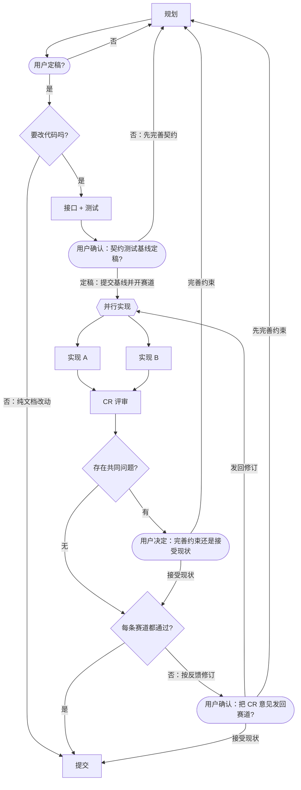

# dsh-racing-code：契约基线用户确认关口 修改计划

> 日期：2026-10-19 ｜ 基线：`0.0.x` @ `4177b4c` ｜ 状态：**已定稿（第二版）**（2026-10-19 用户过 final 关口，进入 contract-tests；接口骨架也在该阶段写）
> 本文是计划文件（plan of record）。草稿与临时产物不进仓库，见同目录 `.gitignore`。

## 0. 用户已拍板

| # | 议题 | 决定 |
|---|---|---|
| 1 | 改动范围 | **本项目流程 + bootstrap `full` 预设 + 测试**（保持"模板 / docs/racing-code.md / README §5"三处同构） |
| 2 | 关口位置 | `contract-tests` 之后、`race` 之前 |
| 3 | 关口语义 | 基线（契约骨架 + 红测试 + 本轮流程文档）**经用户确认后**才提交；确认后提交基线并开赛道；未确认不提交、不开赛道 |
| 4 | 基线提交执行者 | 编排者在当前会话执行（机械 `git`；不是 `commit` 阶段，`commit` 只提交胜者） |
| 5 | `minimal` 预设 | **保持不变**（最小形态；`full` 才与本仓库流程同构） |
| 6 | `contract-tests` 的产物 | **接口 + 测试**：签名 / JSDoc / 骨架也在该阶段写；`baseline` 同时确认接口 diff 与测试 diff；赛道只实现行为 |

## 1. 目标与非目标

**目标**

1. 在本项目流程（`docs/racing-code.md`）的 `contract-tests` 与 `race` 之间加一个用户关口 `baseline`：
   `contract-tests → baseline(["用户确认：契约测试基线定稿?"])`；两条出边
   `"定稿：提交基线并开赛道" → race`、`"否：先完善契约" → plan`。
2. `bootstrap` 的 `full` 预设同构地加这个关口（`lib/bootstrap.js` 的 `graphFor()`），
   生成的新项目也先问用户再提交基线、开赛道。
3. 用测试钉死：full 预设存在 `baseline` 用户关口、它不是阶段、两条出边带条件、
   回边集合新增 `baseline->plan`；`minimal` 预设保持 `contract-tests → race`。
4. 文档同步：`docs/racing-code.md`、`docs/bootstrap.md` §4.1、`README.zh.md` / `README.md` §5。

**非目标**

- 不改 `lib/flow.js` 的解析器：`(["…"])` 用户关口与带条件出边是既有语法，无需新代码；
- 不改 `minimal` 预设、不改 lane 结构、不改 `maxStageRepeats` / `maxReviewRounds`；
- 不加新诊断码；不改 `commit` 阶段的胜者语义；
- 纯文档改动（`needs-code` 走"否"）仍然直达 `commit`，不经过 `baseline`。

## 2. 现状与证据

| 事实 | 位置 |
|---|---|
| 当前本项目流程 `contract-tests` 直接连 `race` | [docs/racing-code.md](../racing-code.md#L40-L41)；`flow_stages` 的 next 只有 `race` |
| 基线必须先落到 `0.0.x`，赛道才能从 HEAD 开分支 | 历史提交 `a58e0db contract: … (red)`；lane worktree 由 `workBranch` 派生 |
| 执行时是"跑红 → 提交基线 → 开赛道"一气呵成，没有用户检查点 | 上一轮实际执行顺序；`contract-tests` 小节没有"提交/开赛道"的授权句 |
| bootstrap `full` 预设同样直接 `contract-tests --> race` | [lib/bootstrap.js](../../lib/bootstrap.js) `graphFor()` |
| full 预设与本仓库流程、README §5 有三处同构要求 | [docs/bootstrap.md](../bootstrap.md) §10 R10；`bootstrap_full_template_carries_the_confirm_user_gate` 测试 |
| 真实流程文件被测试直接加载 | [test/flow.test.mjs](../../test/flow.test.mjs#L31)、`the repository flow file resolves cleanly …` 钉死回边集合 |
| full 预设回边集合被测试钉死 | [test/bootstrap.test.mjs](../../test/bootstrap.test.mjs) `bootstrap_entry_and_labeled_back_edges` |

一句话：图里没有这个检查点，所以编排者只能"按图"直接提交与发车；加上节点后，
`flow_stages` 会把它作为 `contract-tests` 的下一步暴露出来，漏掉它就会在会话里肉眼可见。

## 3. 设计

### 3.1 新节点与两条出边



- `baseline` 是**用户关口**（`(["…"])`，stadium），**不是阶段**：不进 `stages`、不占 `models:`、
  没有 `### baseline` 阶段说明；
- 入口仍是 `plan`；`baseline → plan` 是一条新的**阶段回边**（`maxStageRepeats` 生效），
  因此"否"的选择与 `gate` / `confirm → plan` 同一语义；
- 出边文字就是 `ask_user_question` 的选项；等待给足（≥10 分钟）。

**关口材料（提问前先发全）**

1. `npm test` 的红输出（失败原因逐条：骨架 `not implemented` / 断言失败）；
2. 契约 diff 摘要：`lib/` 的导出签名与 JSDoc 骨架、`test/` 新增/改动用例；
3. 拟用的基线提交信息（前缀 `contract:`）与将要 `git add` 的文件清单；
4. 赛道计划：`flow_stages` 给出的 worktree / 分支 / 模型，以及赛道从哪个基线提交开分支；
5. 建议与依据：契约是否已定稿、有没有未决的契约问题。

**用户选"定稿"之后**

1. 只 `git add` 基线文件（契约骨架 + 测试 + 本轮流程文档），在 `0.0.x` 上提交，
   message 前缀 `contract:`；不夹带无关改动；
2. 把两条赛道同步到该基线：复用原 worktree / 原分支 / 原模型，
   `implement-a` 与 `implement-b` 的 HEAD 重置到基线提交（上一轮实现已在胜者分支里，不重放）；
   `implement-b` 若没有 worktree，按 `laneDir: branch` 新建 `0.0.x-racing/implement-b`；
3. 才进入 `race`：同一条消息里同时发起两条赛道。

**用户选"否"**：不提交、不开赛道，回 `plan` 补契约（与 `contract-tests` 现有约定一致：
"契约本身有问题就停下来说明，回到 `plan`"）。

### 3.2 为什么单独加一个节点，而不是写进 `contract-tests` 的说明

- **图是权威**：`contract-tests` 的阶段说明是"建议文本"，漏读不会报错；节点会被 `flow_stages`
  作为 next 暴露，出边文字就是选项，编排者很难跳过；
- **动作可分辨**："写测试"和"提交基线 + 发两条车"是两类动作：后者不可逆、成本高（两条赛道 x 模型），
  值得单独一个用户确认；
- **代价**：每次要改代码的流程多一次用户介入（一次 `ask_user_question`）；
- **失效症状（不加时）**：编排者提交了错误的契约基线并开赛道，两条赛道都按错标准实现，
  CR 才发现契约级共同问题，整轮作废，回到 `plan` 重来。

### 3.3 bootstrap `full` 预设：接口与实现分开

**接口在 `contract-tests` 写**（用户反馈：接口编码不交给赛道）：在 `lib/bootstrap.js` 里加一个内部函数骨架

```js
/**
 * The `baseline` user gate ...（JSDoc：只由 full 预设使用；返回 gate 节点声明 + 两条带条件出边）
 * @returns {string[]} Exactly three mermaid lines ...
 */
function baselineGateLines() {
  throw new Error('not implemented')
}
```

**行为在赛道写**：实现 `baselineGateLines()` 的函数体（三条 mermaid 行），并在 `graphFor('full')` 的
`contract-tests` 之后接入；`minimal` 预设保持 `contract-tests --> race{{"并行实现"}}` 不变。

- `baseline` 不是阶段，`stages` 数组、逐节点模型选项卡、`## 阶段说明` 都不增加它；
- 阶段顺序不变：`plan, contract-tests, implement-a, implement-b, cr, commit`；
- 回边集合从 4 条变成 5 条：新增 `stage baseline->plan`；
- `BRIEFS['contract-tests']` 的文案同步改为"写接口（签名 + JSDoc + 骨架）与对应测试（先红后绿）；不写实现"，
  并在 `baseline` 关口确认接口与测试（这条文案是接口/规格的一部分，放在契约阶段改）。

### 3.4 测试钉死（先红）

**`test/bootstrap.test.mjs`**

- `bootstrap_entry_and_labeled_back_edges`：full 回边集合改为
  `['review confirm->race', 'stage baseline->plan', 'stage confirm->plan', 'stage final->plan', 'stage gate->plan']`；
- 新用例 `bootstrap_full_template_carries_the_baseline_user_gate`：
  - `baseline` 存在、`kind === 'user_gate'`；
  - `contract-tests.next` 只有 `baseline`；
  - `baseline.next` 的 `to` 集合是 `['plan', 'race']`、`when` 集合是
    `['定稿：提交基线并开赛道', '否：先完善契约']`；
  - `baseline` 不在 `stages` 里；
  - `minimal` 预设没有 `baseline`，且 `contract-tests.next` 是 `race`；
  - 接口骨架（`baselineGateLines()` 的签名 / JSDoc / `throw not implemented`）与测试一起进入 baseline；
    测试只断言渲染结果，不直接调用内部函数（接口不导出）。

**`test/flow.test.mjs`**

- `the repository flow file resolves cleanly, with lanes and a review loop`：真实流程的回边集合加
  `'stage baseline->plan 3'`；
- 加一条断言：真实流程里 `contract-tests.next` 是 `baseline`，`baseline.next` 带两条条件边。

### 3.5 文档同步

| 文件 | 改什么 |
|---|---|
| `docs/racing-code.md` | 图 + 开头两段（"契约基线经用户确认后才提交/开赛道"）+ 「非赛道节点都是用户关口」名单加 `baseline` + `contract-tests` 小节补"接口也在本阶段写、`baseline` 同时确认接口与测试、跑红后不要直接提交/开赛道" |
| `docs/bootstrap.md` §4.1 | full 预设图与说明同步；回边集合改为 5 条；补"2026-10-19 加 baseline 关口" |
| `README.zh.md` / `README.md` §5 | "本仓库自己也在用"一句补上 `baseline` 关口；契约测试表格行补一句"基线定稿后才提交/开赛道" |
| `docs/plan/2026-10-19-baseline-gate.md` | 本文件 |

`minimal` 示例（README §5 图、`docs/workflow-format.md` §12）不动：它们展示的是最小形态。

## 4. 契约（先红）要点

- 先改测试与文档（回边集合、新关口用例、真实流程断言），跑 `npm test`；
- 红的判据：接口骨架 `baselineGateLines()` 已写下并抛 `not implemented`，但 `lib/bootstrap.js` 的 full 预设
  还没有接入 `baseline`（`baseline` 节点缺失 / 回边集合少一条 / `contract-tests.next` 仍是 `race`），
  失败原因与"还没实现"一致；
- 测试定稿后赛道不得修改 `test/`；契约本身有问题就回 `plan`。

## 5. 文件级改动清单

| 文件 | 动作 | 内容 |
|---|---|---|
| `docs/plan/2026-10-19-baseline-gate.md` | 新建 | 本计划 |
| `docs/racing-code.md` | 改 | 新关口 + 说明（本仓库流程） |
| `docs/bootstrap.md` | 改 | §4.1 模板图/说明/回边集合 |
| `README.zh.md` / `README.md` | 改 | §5 本仓库流程说明 |
| `test/bootstrap.test.mjs` | 改 | 回边集合 + 新关口用例 |
| `test/flow.test.mjs` | 改 | 真实流程回边集合 + 关口断言 |
| `lib/bootstrap.js` | 改（契约阶段） | `baselineGateLines()` 签名 + JSDoc + `throw not implemented`；`BRIEFS['contract-tests']` 文案 |
| `lib/bootstrap.js` | 改（赛道） | 实现 `baselineGateLines()` 函数体；`graphFor('full')` 在 `contract-tests` 后接入；`minimal` 不动 |

## 6. 里程碑

1. **M1 计划定稿**：本文过 `final`；
2. **M2 契约（先红）+ 接口 + 文档**：改两个测试文件与三处文档，在 `lib/bootstrap.js` 写 `baselineGateLines()` 骨架
   与 `BRIEFS['contract-tests']` 文案，`npm test` 红（接口未实现、full 模板缺 baseline）；
3. **M2.5 `baseline` 新关口**：按本计划第 3.1 节交给用户确认；确认后提交基线（docs + tests）并把赛道同步到基线；
4. **M3 赛道**：两条并行赛道（不同模型）只改 `lib/bootstrap.js` 的实现部分（函数体 + 接入），
   不改接口签名、不改 `test/`，各自提交；
5. **M4 CR + 提交**：评审 → 按赛道发回 → 给胜者 → 合入 `0.0.x`。

## 7. 验收标准

- `cd 0.0.x && npm test` 全绿；
- `flow_stages`：`contract-tests.next` 是 `baseline`，`baseline.next` 两条边带条件文字，
  回边列表含 `baseline->plan`，`stages` 仍是 6 个；
- `renderBootstrapTemplate({template:'full'})` 0 error、入口 `plan`、含 `baseline` 用户关口；
  `minimal` 无 `baseline`；
- baseline 关口材料同时含**接口 diff**（`baselineGateLines()` 签名 / JSDoc）与**测试 diff**；
  赛道没有改接口签名、没有改 `test/`；
- 本轮实际经过新关口：契约跑红后先给用户材料、用户选"定稿"后才提交基线并开赛道（会话记录可验证）；
- README / docs 的图与 `flow_stages` 输出一致（链接与回边集合交叉检查）。

## 8. 风险

| 风险 | 缓解 |
|---|---|
| 自指：改 `docs/racing-code.md` 会立刻改变本会话的流程 | 改动放在契约阶段、提交前先跑 `flow_stages` 核对；本轮正好用它自己验证 |
| 赛道基线不同步：lane 分支落后于基线 | 开赛前把两条 lane 重置到基线提交（复用 worktree/分支/模型，不重放上一轮实现） |
| 回边集合被两处测试钉死，漏改一处就红 | M2 同时改 `test/bootstrap.test.mjs` 与 `test/flow.test.mjs`；以 `npm test` 为准 |
| 三处文档漂移（模板 / 本仓库流程 / README） | §3.5 一次改齐；测试断言结构，不做全文快照 |
| 每次改代码多一次用户介入 | 纯文档路径不过 `baseline`；这是用户明确要求的安全阀 |
| 接口 / 行为切分被赛道越界 | 接口签名与 JSDoc 在契约阶段写死；测试只断言渲染结果；CR 核对赛道没有改签名与 `test/` |

## 9. 未决问题

无。若 `final` 关口用户要求改标签/出边文字，只改 §3.1 与对应测试断言。
