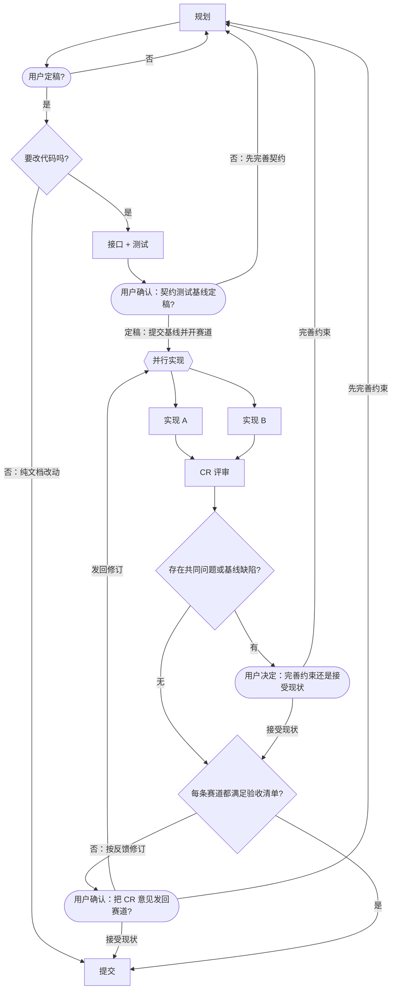

# dsh-racing-code 自己的工作流程

这份文件就是这个项目的"每项目一份流程 markdown"：本仓库的会话里，编排者按下面这张图推进任务；
每个阶段用哪个模型见 front-matter（也可用 `flow_stages` 工具查）。
**声明了模型**（front-matter 或图内标注写了 `provider/model`）的阶段才委派子代理；**未声明**（`session` 或缺键）的**在当前会话直接执行**；赛道（lane）结构上永远委派（lane 选 `session` = 子代理继承会话模型）。**没有按阶段命名的例外**——`commit` 委派是因为配置里给它声明了 `kilo/kilo-auto/free`。

写代码之前先用文档把设计说清楚（**设计不写代码**），设计被用户明确确认后才进入实现；
契约测试基线定稿后**先过 `baseline` 用户关口**：用户确认后才提交基线、才开赛道；
实现阶段**两个模型各开一条赛道**（各自一个 git worktree，子代理显示名 = `<节点词干>-<model>`），CR 逐轮把各自的问题发回对应赛道
（**发回之前先由用户确认**：图上 `confirm` 关口），**改到每条赛道都通过才定胜负、提交**。

**非赛道节点都是用户关口**：图上除 lane（赛道）以外的每个节点——`plan` / `final` / `needs-code` / `contract-tests` / `baseline` / `cr` / `common` / `verdict` / `gate` / `confirm` / `commit`——它的结论都由**用户**下。执行方先干完该节点的活（在当前会话执行或委派子代理），再把**完整材料**发出来（问题清单逐条、diff 摘要、建议与依据），用 `ask_user_question` 让用户按出边文字选，等待给足（≥10 分钟）。
选项卡片只是**快捷方式**，不是唯一输入：每次提问都要允许用户填写**自由文本 / 人工意见**（CR 阶段尤其要显式邀请"人工 CR 意见"，可留空）；用户只写文字、不选卡片也算有效回答；文字必须被处理，不能丢弃；文字与选项冲突时停下问清楚，不自行合并。
**唯一的例外是 lane（赛道）节点**：lane 内部由赛道子代理自行迭代（它是被比较的"作品"）；**lane 之外的每一步都不得替用户拍板**——包括"两条赛道都通过"的 `verdict`，与进入 `commit` 之前。

**纯文档改动不走赛道**：定稿后由 `要改代码吗?` 判定——只改文档（README / `docs/*.md`）就直接收口提交，
不写契约测试、不开赛道（那两样对文档没有可比性）。

格式与语义见 [workflow-format.md](workflow-format.md)——本文件同时也是该格式的一个实例。

---

## 阶段说明

### plan

**在当前会话直接执行**（路由 session，不委派子代理）。

产出**设计文档**，不写代码：

- 改 `README.zh.md` / `README.md` / `docs/*.md`，必要时新增文档；
- 每个设计决策都要写清"为什么这样选、代价是什么、失效时什么症状"；
- 决策点若有两个以上合理选项，先问用户，不要替用户拍板；
- 写清**验收标准**（可逐条判定的条目）与需求来源；CR 据此判断"需求是否被真正满足"，不依据"测试是否全绿"；
  验收标准缺失会在 CR 被退回；
- 产出：diff + 一段"改了什么、还留了哪些未决问题"的汇报。

### contract-tests

**在当前会话直接执行**（路由 session，不委派子代理）。

先定接口与契约，再写测试，**这一步不写实现**，而且**这一步的产物是两条赛道的共同标准**
（TDD 的三步顺序与用例质量要求就落在本节，本项目不依赖全局技能）：

- 在 `lib/*.js` 里写下导出签名与 JSDoc 契约（可以是抛 `not implemented` 的骨架）；
- **接口也在本阶段写**：签名 / JSDoc / 模板与图的骨架都算接口；`baseline` 关口同时确认**接口 diff 与测试 diff**，
  赛道只实现行为（函数体、接入与渲染），不得再改接口签名或测试断言；
- 赛道在 `/home/liumenghan/dsh-racing-code/0.0.x-racing/<lane-id>`（分支名即目录名；前缀见项目配置 `.dsh/racing-code.yml` 的 `workBranch: 0.0.x`）；
- 在 `test/*.test.mjs` 里按契约写用例（`node --test`），**三类都要有**：
  - **正常路径**：契约承诺的主行为；
  - **边界**：空集合、零/负值、阈值相等、刚好越界一档；
  - **失败路径**：非法入参、依赖缺失、上游失败时的降级语义；
- 断言**行为与产出**，不断言私有实现（不 mock 内部私有方法，不断言内部集合类型与调用次数——除非并发/资源语义本身就是契约）；
- 跑一次 `npm test`，确认**红**，并把红的输出贴进汇报；红的**判据**：失败原因必须与"还没实现"一致
  （骨架抛 `not implemented`，或断言失败）——**一写就是绿的用例说明它没在测任何东西**，先修用例，不要往下走；
- 测试定稿后**赛道不得修改**；契约本身有问题就停下来说明，回到 `plan`；
- 跑红后**不要直接提交基线、不要发起赛道**：把接口 diff、测试 diff、红输出、**契约假设清单**（哪些前提依赖口头约定
  或示例）与**测试盲区**（哪些验收项没有测试）、拟用的基线提交信息与赛道计划（worktree / 分支 / 模型）
  交给用户，走图上 `baseline` 关口——假设与盲区要在开赛道**之前**就交出来，而不是等 CR 的基线审计才发现；用户选"定稿：提交基线并开赛道"后才提交基线
  （message 前缀 `contract:`）并进入 `race`；选"否：先完善契约"就回 `plan`。

### implement-a

两条**并行**赛道，同一份契约、不同模型，互不干扰（另一条是 `implement-b`，约束相同、只换路径与分支）：

- 只有你的 worktree 是你的：`/home/liumenghan/dsh-racing-code/0.0.x-racing/implement-a`，分支 `0.0.x-racing/implement-a`；主工作区（`0.0.x/`）别动；
- 所有命令用 `cd <worktree> && …`，文件工具用该目录下的绝对路径；
- 只改 `lib/`，**不得**改 `test/` 里的断言，**不得删除、跳过（skip）或注释掉**用例；
- 写**最小实现**让测试转绿：不为没写过的测试加代码，不做投机性扩展；
- 全绿后可以重构（提方法、换结构、换实现），但**重构不改行为**：测试一行不改，仍然全绿；
- 不要去看另一条赛道的 worktree：独立作答才有比较价值；
- 发起时 `description` 用 **`<节点词干>-<model>`**（逐节点，照抄 `flow_stages` 的「子代理显示名」行，如 `implement-deepseek-v4.1-flash`），多赛道并行时才认得出谁是谁；
- 产出：diff 摘要 + `npm test` 输出 + **每条结论的证据（文件:行 / 测试名 / 命令输出）** + 你认为自己没做好的地方；
  **没有证据的结论 CR 不会采信**；
- 做完把改动提交到 `0.0.x-racing/implement-a`（message 前缀 `round 1:`）。

### implement-b

两条**并行**赛道，同一份契约、不同模型，互不干扰（另一条是 `implement-a`，约束相同、只换路径与分支）：

- 只有你的 worktree 是你的：`/home/liumenghan/dsh-racing-code/0.0.x-racing/implement-b`，分支 `0.0.x-racing/implement-b`；主工作区（`0.0.x/`）别动；
- 所有命令用 `cd <worktree> && …`，文件工具用该目录下的绝对路径；
- 只改 `lib/`，**不得**改 `test/` 里的断言，**不得删除、跳过（skip）或注释掉**用例；
- 写**最小实现**让测试转绿：不为没写过的测试加代码，不做投机性扩展；
- 全绿后可以重构（提方法、换结构、换实现），但**重构不改行为**：测试一行不改，仍然全绿；
- 不要去看另一条赛道的 worktree：独立作答才有比较价值；
- 发起时 `description` 用 **`<节点词干>-<model>`**（逐节点，照抄 `flow_stages` 的「子代理显示名」行，如 `implement-mimo-v2.6-flash`），多赛道并行时才认得出谁是谁；
- 产出：diff 摘要 + `npm test` 输出 + **每条结论的证据（文件:行 / 测试名 / 命令输出）** + 你认为自己没做好的地方；
  **没有证据的结论 CR 不会采信**；
- 做完把改动提交到 `0.0.x-racing/implement-b`（message 前缀 `round 1:`）。

### cr

**在当前会话直接执行**（路由 session，不委派子代理）；关口提问带**完整材料 + 建议 + 依据**，等待给足。

CR 要回答三件事：**需求被真正满足了吗？基线本身对吗？赛道自己的证据成立吗？** 按下面五步做，顺序不能换：

0. **冻结标准（在读任何 lane diff 之前）**：从 plan 文档的「需求 + 验收标准」、用户需求原文和本轮契约里，先写出两张表：
   - **验收清单**：每条都能被证据判定，覆盖正常路径 / 边界 / 失败路径；验收标准缺失或不可判定 → 停下问用户，
     **不得自己发明标准**；
   - **基线断言清单**：契约、测试、文档里哪些前提还没被证明（「docs 不写 7」「按挂单日」「不加 cache 是刻意的」
     都是断言，不是事实）。
   清单一旦冻结，本轮不因赛道表现而改；要改就记为**基线问题**，走 `gate`。
1. **审基线（把基线当被告，而不是尺子）**：逐条核对基线断言——与需求原文、上游文档、已有行为是否一致，证据是什么。
   **基线是本会话上一轮写的，不因为作者是「我」就免检**；契约与测试是工具，不是需求本身；规范也可能写错。
   每条结论只有三类：**成立 / 基线缺陷 / 说不清**；后两类都是**基线问题**（不是某条赛道的错），走 `gate`。
   **「回 plan 改基线」是 CR 的正确产出，不是 CR 失败**；为了让 gate 过而维持错误基线才是失败。
2. **列共有模式（比较式 CR 的反面）**：显式列出两条赛道**相同或同样缺失**的行为——都缺 cache、都用 union/判空绕路、
   文档都没写某条规则、都只做到测试下限……每条给且只给三种处置：
   - **有证据证明正确**：写清为什么（引用需求/文档/行为证据，不能写「两边都这样」）；
   - **基线缺陷**：走 `gate`；
   - **用户接受**：记入已接受清单，写明接受理由（「两边一样」不是理由）。
   **「两边一样」只说明两条赛道读到同一份基线，不是正确性证据**；拿不准 → 默认按基线缺陷走 `gate`。
   两条赛道对同一需求做了相反决定，多半是基线歧义，同样按共同问题处理。
3. **核对赛道自述（证据优先）**：赛道报告里的每条结论逐条核对，标为 `已验证（文件:行 / 测试名 / 命令输出）`、
   `不成立（反证：…）` 或 `无法验证（没有证据）`。**意图声明不算证据**：需求/约束里没写豁免，
   「刻意不加 cache」不能抵消缺陷；**无法验证的结论不能作为「通过」依据**，写进报告的「未验证清单」。
4. **逐赛道评审：对照验收清单**（不是 A 对 B）：对每条 lane：`git -C <worktree> diff`（第 2 轮起只看本轮新增）、读 `lib/` 与
   `test/`、**在该 worktree 里**跑 `npm test`，再对验收清单逐条给 A/B 各自的结论与证据（用「验收项 × 赛道」矩阵，
   把两边都不过的格子显性化）。A/B 差异只在两处使用：① 发现基线歧义（同一需求相反决定 → 按共同问题处理）；
   ② 全部通过后按改动量定胜负（第 11 条）。
5. 按类归并问题：契约/测试缺口、实现缺陷、约束违背（与 `docs/workflow-format.md` 不一致）、风格；每条问题带
   **证据与严重度（阻塞/非阻塞）**。每条共同/基线问题追一层：**哪条约束没说清**，建议补到哪个文件
   （`docs/workflow-format.md`、`docs/architecture.md`、`AGENTS.md`、或补一条测试）；
6. **人工 CR 意见入口**：任何 CR 用户关口（`gate` / `verdict` / `confirm`）的提问里都明确写
   "也可直接填写人工 CR 意见（可留空）"，并读取自由文本；用户只写文字、不选卡片也算回答。
   人工意见按赛道切分：
   - 单赛道问题 → 随该赛道的问题在 `confirm` 后发回；
   - 两条赛道的同类问题 / 约束缺口 → 按共同问题处理（仍走 `gate`，由用户选完善约束/接受现状）；
   - 无法归属或与选项冲突 → 停下问清楚，不自行合并；
7. 有**共同问题或基线问题** → 用 `ask_user_question` 原样反馈，请用户在图上 `gate` 的两个选项里选；
   **提问材料必须含第 0–4 步的验收矩阵、基线审计表、共有模式清单与自述核对表**；提问保留自由文本入口；
   用户写下的共同问题同样按 `gate` 处理。选"接受现状"要**逐条写接受理由**再记入已接受清单，
   后续轮次不再当阻塞问题；
8. **把任何意见发回赛道之前，必须走图上 `confirm` 用户关口**（`ask_user_question`，选项就是它的
   三条出边）："发回修订"才继续第 9 步；"先完善约束" → 回 `plan`；"接受现状" → 直接进 `commit`。
   提问保留自由文本入口；用户在 `confirm` 写下的人工意见，按赛道切分后与 CR 自动问题一起发回；
   **不得丢弃，也不得未经用户确认就 `send_message` 发回赛道**；
9. **单赛道问题** → 用户确认后按赛道切分，`send_message` 发回该赛道原来的子代理，让它在原 worktree、
   原分支上修订并提交（不要告诉它另一条赛道的问题，也不要给评分对比）；
10. **通过判定（写进 verdict 材料，逐条写）**：一条赛道「通过」= **验收清单逐条满足且有证据**
    + **基线审计没有未决的基线问题** + **没有阻塞的实现/约束问题**。**测试全绿、契约没改、测试没改都不是
    「通过」**——它们只是最低约束；为了「让 gate 过」而收窄问题、放过共有模式、或把测试绿当需求满足，
    属于 CR 失职；
11. **只有两条赛道都没有阻塞问题时，才给出胜者建议**（评分依据写清）+ 落选赛道值得挑取的地方；
    **两条都通过、且都不存在明显问题时：改动少的胜出**——比相对契约提交的 `git diff --stat` 净改动行数，少者胜；
    改动量相当才比风格与可读性。改动小 = 行为面小、回归风险小，也让"最小实现"这条约束可被度量；
12. **`verdict` 是判定，按开头「非赛道节点都是用户关口」走**：把完整材料（每条 lane 的问题清单逐条全文、
    第 0–4 步的验收矩阵与三张表、两条 diff 摘要、评分与胜者建议）用 `ask_user_question` 交给用户选图上那两条出边
    （`是` / `否：按反馈修订`）；提问保留自由文本入口。**用户只要写了人工 CR 意见，就按
    "否：按反馈修订"处理**（即使同时选了"是"），先走 `confirm`；只有"是"且没有人工意见才允许进 `commit`——
    不得由 CR/编排者自行判定后直接提交；
13. 还有一条不通过就回到 `race` 开下一轮；超过 `maxReviewRounds` 仍不通过 → 停下问用户；
14. 只有一条赛道成功时，明确写"共同问题**无法判定**"。

**CR 报告的固定结构**：验收清单 + 「验收项 × 赛道」矩阵、基线审计表（断言 | 来源 | 证据 | 结论）、
共有模式清单（模式 | A/B 表现 | 处置 | 依据）、自述核对表（结论 | 证据 | 已验证/不成立/无法验证）、
每赛道问题清单（逐条全文、带证据与阻塞/非阻塞）、共同/基线问题、**用户的人工 CR 意见（逐条，与自动问题分开）**、
通过判定与胜者建议、未验证清单（不能作为通过依据）。
**回答"无共同问题"时**：共有模式清单必须为空，或每条都有"有证据的正确 / 用户接受"处置，否则不允许走 `verdict`。

### commit

本阶段在配置里**声明了模型**（`kilo/kilo-auto/free`）→ 委派子代理执行；没声明就在当前会话执行。胜者**合入当前工作分支**（`0.0.x`），**不直接落 `main`**；落败分支保留。

收口与提交（**进入本阶段的前提：`verdict` 已由用户确认"是"**）：

- **先看这轮有没有赛道**：`要改代码吗?` 走"否"（纯文档改动）就直接收口——不跑契约测试、不看赛道 diff；
  只有在跑过赛道时才适用下面那几条；
- 有赛道时：提交**胜者**那条赛道（`git -C <worktree> …`），落选赛道**不删分支**；
- 有赛道时：看一遍 `git diff`，核对是否严格按"契约测试 → 实现"的顺序发生；
- 收口前跑一遍验证命令（`npm test`、文档链接与诊断码交叉检查等），结果写进汇报；
- 文档若与实现漂移，回到 `plan` 阶段补文档（不要在这里偷偷改）；
- 写 commit message：一句话说清"做了什么"，正文列出验证方式与胜者（有赛道时）；
- 有赛道时：提交后清理落选赛道的 worktree 目录（`git worktree remove`，分支保留）；
- 把结果汇报给用户：改了什么、验证结果、胜者与已接受清单（有赛道时）、以及**仓库当前还不是 git 仓库**时
  说明"提交"这一步只做到了收口（等 `git init` 之后再补真正的提交）。
